# Modelo de Base de Datos - "Qué planes hoy"

Este documento contiene la arquitectura de datos, diagrama entidad-relación (ERD), catálogo de tablas y la descripción detallada de cada campo utilizado por **TypeORM** y **PostgreSQL**.

> 💡 **Documentación complementaria:** Para consultar los diagramas de secuencia, casos de uso y flujos operativos (compra, validación QR, creación, cupones y liquidación), consulta [workflows.md](file:///d:/Personal/apiqueplaneshoy/.antigravity/workflows.md).

---

## 1. Diagrama Entidad-Relación (ERD)

```mermaid
erDiagram
    USERS ||--o{ SOCIAL_IDENTITIES : "vincula"
    USERS ||--o{ USER_FAVORITE_EVENTS : "guarda favoritos"
    USERS ||--o{ ORGANIZER_BANK_ACCOUNTS : "registra cuentas"
    USERS ||--o{ EVENTS : "organiza"
    USERS ||--o{ ORDERS : "compra"
    USERS ||--o{ TICKETS : "posee"
    USERS ||--o{ COUPONS : "crea"
    USERS ||--o{ EVENT_ADVANCES : "solicita anticipo"
    USERS ||--o{ EVENT_SETTLEMENTS : "solicita liquidacion"

    EVENTS ||--o{ USER_FAVORITE_EVENTS : "es favorito de"
    EVENTS ||--o{ EVENT_IMAGES : "contiene"
    EVENTS ||--o{ SHOWS : "programa"
    EVENTS ||--o{ ZONES : "define aforo y precio"
    EVENTS ||--o{ COUPONS : "aplica cupones"
    EVENTS ||--o{ ORDERS : "recibe ordenes"
    EVENTS ||--o{ EVENT_ADVANCES : "otorga anticipos"
    EVENTS ||--o| EVENT_SETTLEMENTS : "liquida 1 a 1"

    ZONES ||--o{ ZONE_PRICING_TIERS : "preventas escalonadas"
    SHOWS ||--o{ TICKETS : "emite para"
    ZONES ||--o{ TICKETS : "ubica en"
    ZONE_PRICING_TIERS ||--o{ TICKETS : "tarifa asignada"

    ORDERS ||--o{ TICKETS : "reserva boletos"
    ORDERS ||--o{ PAYMENTS : "se paga con"
    COUPONS ||--o{ ORDERS : "aplica descuento en"

    USERS {
        int id PK
        uuid public_uuid UK "Identificador publico"
        varchar name "Nombre completo"
        varchar email UK "Email unico"
        timestamptz email_verified_at "Email verificado"
        varchar password_hash "Bcrypt hash"
        varchar role "customer o admin"
        boolean is_organizer "Perfil promotor"
        varchar organizer_name "Nombre comercial"
        varchar organizer_document_type "DNI RUC CE"
        varchar organizer_document_number "Numero documento"
        varchar organizer_phone "Telefono comercial"
        varchar organizer_logo_url "Logo URL"
        timestamptz organizer_verified_at "Fecha KYC"
        timestamptz created_at "Fecha creacion"
    }

    SOCIAL_IDENTITIES {
        bigint id PK
        int user_id FK "Usuario id"
        varchar provider "google facebook"
        varchar provider_id "ID externo red"
        timestamptz created_at "Fecha creacion"
    }

    USER_FAVORITE_EVENTS {
        bigint id PK
        int user_id FK "Usuario id"
        bigint event_id FK "Evento id"
        timestamptz created_at "Fecha guardado"
    }

    ORGANIZER_BANK_ACCOUNTS {
        bigint id PK
        uuid public_uuid UK "Identificador publico"
        int user_id FK "Organizador id"
        varchar bank_name "BCP BBVA Interbank"
        varchar account_type "savings checking"
        varchar currency "PEN USD"
        varchar account_number "Numero cuenta"
        varchar cci "Codigo CCI 20 digitos"
        varchar holder_name "Titular o razon social"
        varchar holder_document_type "DNI RUC CE"
        varchar holder_document_number "Numero documento"
        boolean is_default "Cuenta principal"
        boolean is_active "Estado activo"
        timestamptz verified_at "Verificacion KYC bancaria"
        timestamptz created_at "Fecha creacion"
        timestamptz updated_at "Fecha actualizacion"
    }

    EVENTS {
        bigint id PK
        uuid public_uuid UK "Identificador publico"
        varchar slug UK "URL amigable unica"
        boolean has_landing_page "Flag landing page"
        boolean is_featured "Destacado Hero Carousel (solo admin)"
        int organizer_id FK "Promotor id"
        varchar name "Titulo evento"
        varchar category "CONCERTS THEATER SPORTS FESTIVALS COMEDY GASTRONOMY"
        text_array tags "Tags de busqueda"
        text description "Sinopsis evento"
        varchar age_restriction "ALL_AGES PLUS_14 PLUS_18"
        varchar terms_and_conditions_url "Terminos PDF URL"
        jsonb faqs "Preguntas frecuentes"
        jsonb landing_config "Configuracion landing: header body footer theme con color o patron tile"
        varchar promo_video_url "URL video promocional"
        jsonb social_links "Redes sociales oficiales del evento"
        varchar ubigeo_code "Codigo ubigeo INEI 6 digitos"
        varchar venue "Local recinto"
        varchar address "Direccion fisica"
        varchar address_reference "Referencia lugar"
        varchar coordinates "Coordenadas latitud y longitud"
        varchar google_maps_url "Enlace Maps"
        text entry_requirements "Requisitos acceso"
        text opening_hours_comment "Horarios apertura"
        int user_ticket_limit "Limite boletos usuario"
        varchar signing_key_id "ID llaves"
        text signing_public_key "Llave publica Ed25519"
        varchar status "draft published"
        timestamptz created_at "Fecha creacion"
    }

    EVENT_IMAGES {
        bigint id PK
        bigint event_id FK "Evento id"
        varchar image_url "CDN URL"
        varchar image_type "banner gallery zone_map landing_header landing_body landing_footer"
        int sort_order "Orden galeria"
        timestamptz created_at "Fecha creacion"
    }

    SHOWS {
        bigint id PK
        uuid public_uuid UK "Identificador publico"
        bigint event_id FK "Evento id"
        varchar name "Nombre funcion"
        timestamptz start_time "Inicio funcion"
        timestamptz sales_end_at "Fin de venta funcion"
        int duration_hours "Duracion estimada horas"
        varchar status "scheduled cancelled"
    }

    ZONES {
        bigint id PK
        uuid public_uuid UK "Identificador publico"
        bigint event_id FK "Evento id"
        varchar name "Sector VIP General"
        varchar title "Titulo comercial"
        varchar color "Codigo color HEX"
        text benefits "Beneficios zona"
        int capacity "Aforo total zona"
        int sold_count "Vendidos confirmados"
        int locked_count "Apartados en checkout"
        decimal regular_price "Precio lista taquilla"
        decimal service_fee "Comision ticketera"
        boolean fee_included "Precio incluye comision"
        int max_tickets_per_order "Maximo por orden"
        timestamptz sales_start_at "Inicio de venta"
    }

    ZONE_PRICING_TIERS {
        bigint id PK
        uuid public_uuid UK "Identificador publico"
        bigint zone_id FK "Zona id"
        smallint tier_number "Orden preventa 1 2 3"
        varchar name "Nombre de la preventa"
        decimal price "Precio promocional"
        int capacity "Cupo asignado tier"
        int sold_count "Vendidos en este tier"
        int locked_count "Apartados en este tier"
        timestamptz end_at "Fecha fin preventa"
        boolean is_active "Estado activo"
    }

    COUPONS {
        bigint id PK
        uuid public_uuid UK "Identificador publico"
        bigint event_id FK "Evento id"
        int organizer_id FK "Promotor id"
        varchar code "Codigo cupon"
        varchar discount_type "percentage o fixed"
        decimal discount_value "Valor del descuento"
        varchar usage_type "single_use o reusable"
        int max_uses "Maximo de canjes"
        int used_count "Canjes acumulados"
        decimal min_order_amount "Monto minimo compra"
        timestamptz starts_at "Inicio vigencia"
        timestamptz expires_at "Fin vigencia"
        boolean is_active "Estado activo"
    }

    ORDERS {
        bigint id PK
        uuid public_uuid UK "Token checkout publico"
        int user_id FK "Comprador id"
        bigint event_id FK "Evento id"
        bigint coupon_id FK "Cupon aplicado id"
        varchar status "pending paid expired"
        decimal subtotal_tickets "Subtotal boletos"
        decimal total_service_fee "Comisiones servicio"
        decimal discount_amount "Descuento por cupon"
        decimal total_amount "Total cobrado neto"
        timestamptz created_at "Inicio compra"
        timestamptz expires_at "Limite 10 minutos"
    }

    TICKETS {
        bigint id PK
        uuid public_uuid UK "Token ticket publico"
        bigint show_id FK "Funcion id"
        bigint zone_id FK "Zona id"
        bigint pricing_tier_id FK "Preventa tier id"
        int user_id FK "Duenio id"
        bigint order_id FK "Orden id"
        decimal paid_base_price "Tarifa congelada pagada"
        decimal paid_service_fee "Comision congelada"
        varchar qr_code UK "Token firmado QR"
        varchar status "available locked sold used"
        timestamptz locked_until "Bloqueo temporal 10m"
        timestamptz scanned_at "Hora escaneo puerta"
    }

    PAYMENTS {
        bigint id PK
        uuid public_uuid UK "Comprobante publico"
        bigint order_id FK "Orden id"
        varchar payment_method "Metodo de pago"
        decimal amount "Monto procesado"
        decimal gateway_fee_amount "Comision pasarela"
        varchar status "pending approved rejected"
        varchar external_transaction_id "ID pasarela externa"
        jsonb gateway_response "Payload crudo pasarela"
        timestamptz created_at "Fecha de pago"
    }

    EVENT_ADVANCES {
        bigint id PK
        uuid public_uuid UK "Recibo publico"
        bigint event_id FK "Evento id"
        int organizer_id FK "Promotor id"
        decimal amount "Monto anticipo"
        varchar status "requested approved paid"
        varchar bank_name "Banco abono"
        varchar bank_account_number "Cuenta bancaria"
        varchar bank_account_cci "Codigo CCI"
        varchar transfer_reference "Numero operacion"
        varchar transfer_voucher_url "Voucher PDF URL"
        timestamptz requested_at "Fecha solicitud"
        timestamptz paid_at "Fecha pago"
    }

    EVENT_SETTLEMENTS {
        bigint id PK
        uuid public_uuid UK "Certificado publico"
        bigint event_id UK "Evento id unico 1 a 1"
        int organizer_id FK "Promotor id"
        varchar status "in_review approved paid"
        int total_tickets_sold "Total boletos vendidos"
        decimal gross_amount "Recaudacion nominal"
        decimal total_coupons_discount_amount "Total cupones descontados"
        decimal platform_fee_amount "Comision plataforma"
        decimal gateway_fee_amount "Comision pasarela"
        decimal total_advances_amount "Total anticipos restados"
        decimal adjustments_amount "Ajustes penalidades"
        decimal net_payout_amount "Saldo neto a pagar"
        jsonb breakdown_by_zone "Reporte JSON auditado"
        varchar bank_name "Banco abono"
        varchar bank_account_number "Cuenta bancaria"
        varchar bank_account_cci "Codigo CCI"
        varchar transfer_reference "Numero operacion"
        varchar transfer_voucher_url "Voucher final PDF"
        timestamptz requested_at "Fecha solicitud"
        timestamptz paid_at "Fecha pago"
    }
```



---

## 2. Diccionario de Datos por Módulo

### 2.1 Módulo: Usuarios (`users`)

#### Tabla: `users`
*Registra a los clientes finales y organizadores/promotores bajo un modelo de cuenta unificada.*
* **`id`** (`integer`, PK): Identificador interno autoincremental.
* **`public_uuid`** (`uuid`, UNIQUE, INDEX): UUID seguro para evitar exponer IDs secuenciales en el frontend.
* **`name`** (`varchar(100)`): Nombre completo de la persona natural.
* **`email`** (`varchar(150)`, UNIQUE, INDEX): Correo principal para login y envío de tickets.
* **`email_verified_at`** (`timestamptz`, NULL): Fecha y hora en que el usuario confirmó su correo electrónico.
* **`password_hash`** (`varchar(255)`, NULL): Contraseña cifrada con bcrypt (nula si se autentica exclusivamente vía OAuth).
* **`role`** (`varchar(50)`, INDEX): Rol del sistema (`customer`, `admin`).
* **`is_organizer`** (`boolean`, default false, INDEX): Indicador de si el usuario ha habilitado su perfil de organizador para crear y gestionar eventos.
* **`organizer_name`** (`varchar(150)`, NULL): Nombre comercial de la productora o razón social comercial.
* **`organizer_document_type`** (`varchar(20)`, NULL): Tipo de documento de identidad/tributario (`DNI`, `RUC`, `CE`).
* **`organizer_document_number`** (`varchar(20)`, NULL): Número de documento de la productora o titular.
* **`organizer_phone`** (`varchar(30)`, NULL): Teléfono de contacto directo del organizador.
* **`organizer_logo_url`** (`varchar(512)`, NULL): Enlace web del logotipo de la productora en CDN.
* **`organizer_verified_at`** (`timestamptz`, NULL): Fecha de aprobación de verificación de identidad KYC por parte de la administración.
* **`created_at`** (`timestamptz`): Fecha y hora de creación de la cuenta.

#### Tabla: `social_identities`
*Vincula usuarios con proveedores externos como Google o Facebook.*
* **`id`** (`bigint`, PK): Identificador interno.
* **`user_id`** (`integer`, FK -> `users.id`, INDEX): Usuario propietario.
* **`provider`** (`varchar(50)`): Proveedor (`google`, `facebook`, `apple`).
* **`provider_id`** (`varchar(255)`): Identificador único devuelto por la red social.
* **Índice Compuesto Único:** `(provider, provider_id)` para impedir cuentas duplicadas.

#### Tabla: `user_favorite_events`
*Lista de eventos guardados como favoritos por los usuarios (wishlist personal).*
* **`id`** (`bigint`, PK): Identificador interno autoincremental del favorito.
* **`user_id`** (`integer`, FK -> `users.id`, INDEX): Usuario titular que guardó el evento.
* **`event_id`** (`bigint`, FK -> `events.id`, INDEX): Evento marcado como favorito.
* **`created_at`** (`timestamptz`): Fecha y hora en que se agregó a favoritos.
* **Índice Compuesto Único:** `(user_id, event_id)` para impedir guardar duplicados del mismo evento.

#### Tabla: `organizer_bank_accounts`
*Cuentas bancarias registradas por los organizadores para recibir adelantos y liquidaciones.*
* **`id`** (`bigint`, PK): Identificador interno autoincremental de la cuenta bancaria.
* **`public_uuid`** (`uuid`, UNIQUE, INDEX): Identificador público UUID de la cuenta bancaria.
* **`user_id`** (`integer`, FK -> `users.id`, INDEX): Usuario organizador propietario.
* **`bank_name`** (`varchar(100)`): Entidad bancaria (ej: `BCP`, `BBVA`, `Interbank`, `Scotiabank`).
* **`account_type`** (`varchar(30)`, default `'checking'`): Tipo de cuenta (`savings` o `checking`).
* **`currency`** (`varchar(10)`, default `'PEN'`): Moneda (`PEN` o `USD`).
* **`account_number`** (`varchar(50)`): Número de cuenta bancaria local.
* **`cci`** (`varchar(50)`, NULL): Código de Cuenta Interbancario (CCI de 20 dígitos en Perú).
* **`holder_name`** (`varchar(150)`): Titular o razón social de la cuenta bancaria.
* **`holder_document_type`** (`varchar(20)`, NULL): Tipo de documento del titular (`DNI`, `RUC`, `CE`).
* **`holder_document_number`** (`varchar(20)`, NULL): Número de documento del titular.
* **`is_default`** (`boolean`, default false, INDEX): Cuenta predeterminada para desembolsos.
* **`is_active`** (`boolean`, default true): Estado activo de la cuenta.
* **`verified_at`** (`timestamptz`, NULL): Fecha de verificación administrativa de titularidad bancaria.
* **`created_at`** (`timestamptz`): Fecha de registro.
* **`updated_at`** (`timestamptz`): Fecha de última actualización.

---

### 2.2 Módulo: Eventos (`events`)

#### Tabla: `events`
*El espectáculo o concepto general (ej: "Corazón Serrano", "Coldplay Tour", "El Rey León").*
* **`id`** (`bigint`, PK): Identificador numérico interno.
* **`public_uuid`** (`uuid`, UNIQUE, INDEX): UUID público para URLs de detalle (`/events/:uuid`), vistas previas secretas y consumo seguro en APIs móviles.
* **`slug`** (`varchar(150)`, UNIQUE, INDEX): Cadena alfanumérica amigable para la URL pública del evento en el navegador y posicionamiento en Google (ej: `corazon-serrano-pucallpa-2026`).
* **`has_landing_page`** (`boolean`, default false, INDEX): Indicador de si el evento tiene activada la experiencia de Landing Page inmersiva y personalizada (`true`) o se muestra con la plantilla estándar de cartelera (`false`).
* **`is_featured`** (`boolean`, default false, INDEX): Indicador de si el evento está seleccionado como destacado (*Featured*) para exhibirse en el Hero Carousel principal y en las secciones destacadas de la portada web y móvil (`GET /api/v1/events/featured`). Indexado para consultas de alto rendimiento y sincronizado con Meilisearch.
* **`organizer_id`** (`integer`, FK -> `users.id`, INDEX): Usuario responsable del evento (promotor).
* **`name`** (`varchar(255)`, INDEX): Título comercial del evento.
* **`category`** (`varchar(50)`, INDEX): Clasificación oficial normalizada por `EVENT_CATEGORIES`: `CONCERTS` (Conciertos 🎵), `THEATER` (Teatro & Musicales 🎭), `SPORTS` (Deportes ⚽), `FESTIVALS` (Festivales 🎪), `COMEDY` (Comedia & Stand Up 🎤), `GASTRONOMY` (Gastronomía 🍔).
* **`tags`** (`text[]`, default `'{}'`, INDEX GIN): Arreglo de etiquetas o palabras clave del evento para optimización del motor de búsqueda (ej: `['salsa', 'pucallpa', 'vip']`).
* **`description`** (`text`, NULL): Información completa, sinopsis y detalles del espectáculo.
* **`age_restriction`** (`varchar(50)`, default 'ALL_AGES', INDEX): Restricción de edad según `AGE_RESTRICTIONS`: `ALL_AGES` (Para toda la familia 👨👩👧👦), `PLUS_14` (+14 Años ⚠️), `PLUS_18` (Solo Mayores de 18 🔞).
* **`terms_and_conditions_url`** (`varchar(512)`, NULL): Enlace web o documento PDF oficial descargable con las bases y condiciones legales del evento.
* **`faqs`** (`jsonb`, NULL): Arreglo estructurado de preguntas frecuentes del evento en formato `[{"question": "...", "answer": "..."}]`.
* **`landing_config`** (`jsonb`, NULL): Configuración completa de assets y textos para la Landing Page personalizada del evento (incluye `header` con imagen/video teaser y CTA, `body` con banner y 3 atractivos comerciales, `footer` con imagen, redes y auspiciadores, y `theme` con selección de `backgroundType` ('color' o 'pattern'), `backgroundColor` sólido o `backgroundPatternUrl` repetido en mosaico).
* **`promo_video_url`** (`varchar(512)`, NULL): Enlace web del video promocional o teaser oficial del evento (YouTube, Vimeo o archivo MP4/WebM directo en CDN).
* **`social_links`** (`jsonb`, NULL): Enlaces a redes sociales oficiales del evento (`{"instagramUrl": "...", "facebookUrl": "...", "tiktokUrl": "..."}`), configurables desde la fase Multimedia & Portada e integrados en el evento y su landing page.
* **`ubigeo_code`** (`varchar(6)`, NULL): Código de ubigeo oficial INEI de 6 dígitos (departamento, provincia y distrito normalizados según la librería `ubigeo-peru`, eliminando redundancias de texto libre).
* **`venue`** (`varchar(255)`, NULL): Nombre del local o recinto (ej: "Explanada del Estadio", "Teatro Municipal").
* **`address`** (`varchar(255)`, NULL): Dirección física exacta.
* **`address_reference`** (`varchar(255)`, NULL): Referencia para llegar al local.
* **`coordinates`** (`varchar(100)`, NULL): Coordenadas geográficas unificadas en formato `"latitud, longitud"` (ej: `"-8.37915, -74.55387"`), capturadas de forma interactiva con el mapa OpenStreetMap / Leaflet.
* **`google_maps_url`** (`varchar(512)`, NULL): Enlace directo a Google Maps para navegación interactiva o Waze.
* **`entry_requirements`** (`text`, NULL): Requisitos de acceso (documentos, objetos prohibidos, vestimenta).
* **`opening_hours_comment`** (`text`, NULL): Horarios de apertura de puertas y recomendaciones de llegada.
* **`user_ticket_limit`** (`integer`, default 6): Límite global acumulado de entradas por usuario en todo el evento (Regla 1: Por Evento).
* **`signing_key_id`** (`varchar(64)`): Identificador del par de llaves criptográficas del evento para rotación y revocación.
* **`signing_public_key`** (`text`, NULL): Llave pública asimétrica (Ed25519) del evento descargada por los escáneres de puerta para validación offline.
* **`status`** (`varchar(50)`, INDEX): Estado (`draft`, `published`, `paused`, `completed`, `cancelled`). La transición a `completed` se procesa automáticamente a la 1:00 AM por la tarea Cron programada cuando todas las funciones del evento han culminado.
* **`created_at`** (`timestamptz`): Fecha de creación del registro.
* **Índices:** `is_featured` (para cartelera destacada), `status`, `category`, `age_restriction`, `has_landing_page`, `organizer_id` e Índice Compuesto `(status, name)` para optimizar el buscador público de eventos.

#### Tabla: `shows`
*Funciones u horarios específicos de un evento (permite fechas múltiples).*
* **`id`** (`bigint`, PK): Identificador de la función.
* **`public_uuid`** (`uuid`, UNIQUE, INDEX): Identificador público de la función.
* **`event_id`** (`bigint`, FK -> `events.id`, INDEX): Evento al que pertenece.
* **`name`** (`varchar(150)`, NULL): Nombre o título descriptivo de la función (ej: "Función Principal: Noche de Apertura", "Función 2: Gran Clausura").
* **`start_time`** (`timestamptz`, INDEX): Fecha y hora exacta de inicio de la función o apertura de puertas.
* **`sales_end_at`** (`timestamptz`, NULL): Fecha y hora límite en que se cierra la venta de entradas para esta función (si es nulo, cierra en `start_time`).
* **`duration_hours`** (`integer`, default 2): Duración estimada del espectáculo expresada en horas enteras (ej: 1, 2, 3, 4, 5).
* **`status`** (`varchar(50)`, INDEX): Estado (`scheduled`, `ongoing`, `completed`, `cancelled`). Pasa a `completed` automáticamente a la 1:00 AM si su fecha estimada de fin (`startTime + durationHours`) ya expiró.
* **Índice Compuesto:** `(event_id, start_time)` para listar funciones cronológicamente.

#### Tabla: `zones`
*Configuración de localidades, color distintivo, aforos y precio regular de lista.*
* **`id`** (`bigint`, PK): Identificador de la zona.
* **`public_uuid`** (`uuid`, UNIQUE, INDEX): Identificador público de la zona.
* **`event_id`** (`bigint`, FK -> `events.id`, INDEX): Evento que posee esta zona.
* **`name`** (`varchar(100)`): Nombre del sector (ej: "VIP", "GENERAL", "BOX").
* **`title`** (`varchar(150)`, NULL): Título comercial destacado (ej: "Experiencia VIP Box", "Pista General").
* **`color`** (`varchar(7)`, default '#3B82F6'): Color hexadecimal distintivo de la zona (ej: `#EF4444` para VIP rojo, `#10B981` para General verde), utilizado en croquis, badges y tickets.
* **`benefits`** (`text`, NULL): Descripción de la ubicación física en el recinto y beneficios incluidos.
* **`capacity`** (`integer`): Aforo máximo total permitido en esta zona (ej: 200 personas).
* **`sold_count`** (`integer`, default 0): Cantidad acumulada de boletos pagados y confirmados en esta zona.
* **`locked_count`** (`integer`, default 0): Cantidad de boletos retenidos temporalmente en sesiones activas de checkout (se incrementa al reservar y se decrementa al pagar o expirar).
* **`regular_price`** (`decimal(10,2)`): **Precio oficial de venta general de la localidad (precio de lista / taquilla)**. Es el precio que se cobra cuando no hay preventas activas o cuando todas se han agotado, y sirve como precio tachado de referencia durante promociones.
* **`service_fee`** (`decimal(10,2)`): Cargo por servicio de la ticketera por boleto.
* **`fee_included`** (`boolean`, default false): Indica si el precio ingresado incluye la comisión de ticketera (`true` → se descuenta del promotor; `false` → se suma al precio final que paga el comprador).
* **`max_tickets_per_order`** (`integer`, default 4): Cantidad máxima de entradas de esta zona que un cliente puede comprar en una sola transacción/orden (Regla 2: Por Orden).
* **`sales_start_at`** (`timestamptz`, NULL): Fecha y hora en que inicia la venta de entradas de esta zona.
* **`created_at`** (`timestamptz`): Fecha de creación.

#### Tabla: `zone_pricing_tiers`
*Fases de preventa escalonadas por zona (hasta 3 preventas promocionales).*
* **`id`** (`bigint`, PK): Identificador del tier.
* **`public_uuid`** (`uuid`, UNIQUE, INDEX): Identificador público.
* **`zone_id`** (`bigint`, FK -> `zones.id`, INDEX): Zona a la que aplica este escalón de preventa.
* **`tier_number`** (`smallint`): Número ordinal de preventa (`1` para Preventa 1, `2` para Preventa 2, `3` para Preventa 3).
* **`name`** (`varchar(100)`): Nombre promocional de la fase (ej: "Preventa 1 - Early Bird", "Preventa 2 - Fans").
* **`price`** (`decimal(10,2)`): Precio con descuento promocional aplicable a esta preventa.
* **`capacity`** (`integer`): Cupo o stock máximo de boletos asignados exclusivamente a esta fase.
* **`sold_count`** (`integer`, default 0): Boletos pagados y confirmados en este tier de preventa.
* **`locked_count`** (`integer`, default 0): Boletos apartados temporalmente en checkout para este tier.
* **`end_at`** (`timestamptz`, NULL): Fecha y hora límite en que expira este tier (si se alcanza la fecha o se agota `capacity`, pasa automáticamente al siguiente tier o a `regular_price`).
* **`is_active`** (`boolean`, default true): Flag para pausar o forzar el cierre anticipado de una preventa específica.
* **`created_at`** (`timestamptz`): Fecha de creación.
* **Índice Compuesto Único:** `(zone_id, tier_number)` para garantizar que una zona solo tenga un Tier 1, un Tier 2 y un Tier 3.

#### Tabla: `event_images`
*Imágenes promocionales, portadas, mapas de zonas y banners almacenados en Cloudflare R2 con CDN global.*
* **`id`** (`bigint`, PK): Identificador de la imagen.
* **`event_id`** (`bigint`, FK -> `events.id`, INDEX): Evento asociado.
* **`image_url`** (`varchar(512)`): Enlace web del archivo en Cloudflare R2 / CDN público (ej: `https://pub-xxxxxx.r2.dev/banners/1730328900-uuid.webp` o `https://cdn.queplaneshoy.com/...`).
* **`image_type`** (`varchar(50)`, INDEX): Tipo o clasificación (`banner` para portada principal, `gallery` para fotos promocionales, `zone_map` para croquis de localidades, `landing_header` para cabecera del landing, `landing_body` para banner del cuerpo, y `landing_footer` para auspiciadores/pie).
* **`sort_order`** (`integer`, default 0): Posición para ordenar en galerías (índices 0 a 3 para la galería).
* **Estructura de Almacenamiento en Cloudflare R2:** Los objetos se suben mediante URLs prefirmadas (`Presigned URLs`) generadas por el endpoint `POST /api/media/presigned-url` en el bucket correspondiente (`qph-media-dev` / `qph-media-prod`), distribuidos por prefijos virtuales: `/banners`, `/croquis`, `/gallery`, `/landings` y `/organizers`.
* **Regla de Negocio (Galería):** Para el tipo `gallery`, se restringe a un **máximo estricto de 4 fotos oficiales** por evento. Esta restricción garantiza un consumo de ancho de banda ligero y tiempos de carga instantáneos en la vista móvil de compra de entradas.
* **Índice Compuesto:** `(event_id, sort_order)`.

---

### 2.3 Módulo: Órdenes, Tickets y Cupones (`orders`)

#### Tabla: `coupons`
*Cupones de descuento generados por el organizador aplicables al total de la orden.*
* **`id`** (`bigint`, PK): Identificador interno del cupón.
* **`public_uuid`** (`uuid`, UNIQUE, INDEX): Identificador público del cupón.
* **`event_id`** (`bigint`, FK -> `events.id`, INDEX): Evento específico para el cual es válido el cupón.
* **`organizer_id`** (`integer`, FK -> `users.id`, INDEX): Promotor que dio de alta el cupón.
* **`code`** (`varchar(50)`, INDEX): Código que escribe el comprador (ej: "INFLUENCERJUAN", "CYBER20", "PREVENTAVIP"). En mayúsculas normalizadas.
* **`discount_type`** (`varchar(20)`): Tipo de beneficio (`percentage` para descuento porcentual, `fixed` para monto fijo de rebaja en soles).
* **`discount_value`** (`decimal(10,2)`): Magnitud del descuento (ej: `15.00` para 15% de rebaja, o `20.00` para S/ 20.00 de descuento directo).
* **`usage_type`** (`varchar(20)`): Modalidad de uso:
  * `single_use`: Cupón de un solo uso. Una vez canjeado en una orden pagada, se quema y no puede volver a usarse. Válido mientras el evento esté vigente.
  * `reusable`: Cupón reutilizable (ej: código de influencers o alianzas). Permite múltiples canjes hasta alcanzar `max_uses` o su fecha límite `expires_at`.
* **`max_uses`** (`integer`, NULL): Límite total de canjes permitidos en toda la plataforma (nulo si es ilimitado hasta su vencimiento).
* **`used_count`** (`integer`, default 0): Contador acumulado de cuántas órdenes pagadas han consumido el cupón.
* **`min_order_amount`** (`decimal(10,2)`, NULL): Monto mínimo de subtotal requerido para que el cupón sea aceptado en el checkout.
* **`starts_at`** (`timestamptz`, NULL): Fecha y hora en que empieza la vigencia del cupón.
* **`expires_at`** (`timestamptz`, NULL): Fecha y hora de vencimiento. Si es nulo, permanece vigente durante todo el ciclo de venta del evento.
* **`is_active`** (`boolean`, default true): Permite al organizador desactivar manualmente el cupón en cualquier momento.
* **`created_at`** (`timestamptz`): Momento de registro.
* **Índice Compuesto Único:** `(event_id, code)` para impedir códigos duplicados dentro del mismo evento.

#### Tabla: `orders`
*Reserva y transacción de compra en el checkout.*
* **`id`** (`bigint`, PK): Identificador de la orden.
* **`public_uuid`** (`uuid`, UNIQUE, INDEX): Token de orden compartido con el checkout (`/checkout/:public_uuid`).
* **`user_id`** (`integer`, FK -> `users.id`, INDEX): Comprador titular.
* **`event_id`** (`bigint`, FK -> `events.id`, NULL, INDEX): Evento al que corresponde la orden de compra.
* **`coupon_id`** (`bigint`, FK -> `coupons.id`, NULL, INDEX): Cupón de descuento aplicado a la orden (si corresponde).
* **`status`** (`varchar(50)`, INDEX): Estado (`pending`, `paid`, `expired`, `cancelled`, `refunded`).
* **`subtotal_tickets`** (`decimal(10,2)`): Suma de precios base de los tickets adquiridos.
* **`total_service_fee`** (`decimal(10,2)`): Suma de cargos por servicio de ticketera.
* **`discount_amount`** (`decimal(10,2)`, default 0.00): Importe monetario descontado del total de la orden por la aplicación del cupón.
* **`total_amount`** (`decimal(10,2)`): Total final neto a pagar por el cliente (`subtotal_tickets + total_service_fee - discount_amount`).
* **`created_at`** (`timestamptz`): Fecha de inicio de la compra.
* **`expires_at`** (`timestamptz`, INDEX): Hora límite en que expira la reserva si no se paga (configurable vía `CULQI_ORDER_EXPIRATION_SECONDS`, por defecto 15 minutos).
* **Índice Compuesto:** `(status, expires_at)` para el proceso en segundo plano que libera boletos vencidos.

#### Tabla: `tickets`
*Boleto individual con aforo, acceso QR y trazabilidad.*
* **`id`** (`bigint`, PK): Identificador del ticket.
* **`public_uuid`** (`uuid`, UNIQUE, INDEX): Identificador del ticket para billetera digital.
* **`show_id`** (`bigint`, FK -> `shows.id`, INDEX): Función para la que es válido.
* **`zone_id`** (`bigint`, FK -> `zones.id`, INDEX): Sector asignado.
* **`pricing_tier_id`** (`bigint`, FK -> `zone_pricing_tiers.id`, NULL, INDEX): Identificador de la preventa en la que se adquirió el ticket (NULL si fue adquirido al precio regular de taquilla).
* **`user_id`** (`integer`, FK -> `users.id`, NULL, INDEX): Usuario dueño (null si aún no se vende).
* **`order_id`** (`bigint`, FK -> `orders.id`, NULL, INDEX): Orden donde fue adquirido.
* **`paid_base_price`** (`decimal(10,2)`, NULL): Precio base congelado al momento de compra (refleja el precio exacto del tier de preventa o el precio regular en ese segundo).
* **`paid_service_fee`** (`decimal(10,2)`, NULL): Comisión congelada al momento de compra.
* **`qr_code`** (`varchar(255)`, UNIQUE, INDEX): Código único escaneable en puerta con firma digital Ed25519.
* **`status`** (`varchar(50)`, INDEX): Estado (`available`, `locked`, `sold`, `used`, `cancelled`).
* **`locked_until`** (`timestamptz`, NULL): Tiempo de retención temporal mientras el usuario paga en pasarela (por defecto 15 min).
* **`scanned_at`** (`timestamptz`, NULL): Fecha y hora exacta en que el código QR fue validado y consumido en puerta para control de acceso y prevención de doble ingreso.
* **Índices Compuestos:**
  * `(show_id, zone_id)`: Para consultar aforo disponible por función y zona.
  * `(pricing_tier_id, status)`: Para contabilizar boletos vendidos por cada fase de preventa.
  * `(status, locked_until)`: Para el control de concurrencia y liberación de inventario.

#### Tabla: `payments`
*Registro y conciliación con pasarelas de pago.*
* **`id`** (`bigint`, PK): Identificador del pago.
* **`public_uuid`** (`uuid`, UNIQUE, INDEX): Identificador público del comprobante.
* **`order_id`** (`bigint`, FK -> `orders.id`, INDEX): Orden a la que liquida.
* **`payment_method`** (`varchar(50)`): Método (`credit_card`, `stripe`, `paypal`, `yape`, `niubiz`, `culqi`).
* **`amount`** (`decimal(10,2)`): Importe procesado.
* **`gateway_fee_amount`** (`decimal(10,2)`, default 0.00): Comisión cobrada por la pasarela externa en esta transacción.
* **`status`** (`varchar(50)`, INDEX): Estado (`pending`, `approved`, `rejected`, `refunded`).
* **`external_transaction_id`** (`varchar(255)`, NULL, INDEX): Referencia de la pasarela externa.
* **`gateway_response`** (`jsonb`, NULL): Payload y respuesta completa en formato JSON devuelta por la pasarela de pagos para auditoría financiera, trazabilidad de errores bancarios y soporte ante contracargos (*chargebacks*).
* **`created_at`** (`timestamptz`): Momento de procesamiento.

---

### 2.4 Módulo: Liquidaciones y Finanzas (`settlements`)

#### Tabla: `event_advances`
*Registro y control de anticipos a cuenta solicitados por los organizadores durante la venta.*
* **`id`** (`bigint`, PK): Identificador interno del adelanto.
* **`public_uuid`** (`uuid`, UNIQUE, INDEX): Identificador público para constancias de pago / recibos.
* **`event_id`** (`bigint`, FK -> `events.id`, INDEX): Evento que originó la solicitud de adelanto.
* **`organizer_id`** (`integer`, FK -> `users.id`, INDEX): Promotor beneficiario.
* **`amount`** (`decimal(12,2)`): Monto monetario desembolsado a cuenta.
* **`status`** (`varchar(50)`, INDEX): Estado (`requested`, `in_review`, `approved`, `paid`, `rejected`).
* **`bank_name`** (`varchar(100)`, NULL): Banco de abono (BCP, BBVA, Interbank, etc.).
* **`bank_account_number`** (`varchar(50)`, NULL): Número de cuenta bancaria.
* **`bank_account_cci`** (`varchar(50)`, NULL): Código de Cuenta Interbancario (20 dígitos).
* **`bank_account_holder`** (`varchar(150)`, NULL): Titular de la cuenta.
* **`transfer_reference`** (`varchar(100)`, NULL): Nro de operación bancaria de la transferencia.
* **`transfer_voucher_url`** (`varchar(512)`, NULL): Comprobante o voucher bancario en PDF o imagen.
* **`requested_at`** (`timestamptz`): Fecha en que se solicitó el anticipo.
* **`paid_at`** (`timestamptz`, NULL): Momento en que la administración transfirió el dinero.
* **`processed_by_user_id`** (`integer`, NULL): ID del administrador que autorizó el pago.
* **`notes`** (`text`, NULL): Observaciones o motivo de rechazo.

#### Tabla: `event_settlements`
*Cierre contable definitivo y liquidación final (Relación 1 a 1 estricta con el Evento).*
* **`id`** (`bigint`, PK): Identificador de la liquidación final.
* **`public_uuid`** (`uuid`, UNIQUE, INDEX): Token público para descarga del estado de cuenta oficial.
* **`event_id`** (`bigint`, UNIQUE, FK -> `events.id`, INDEX): Evento liquidado. La restricción UNIQUE garantiza que un evento solo se liquide una vez.
* **`organizer_id`** (`integer`, FK -> `users.id`, INDEX): Promotor titular.
* **`status`** (`varchar(50)`, INDEX): Estado (`requested`, `in_review`, `approved`, `paid`, `rejected`).
* **`total_tickets_sold`** (`integer`): Cantidad total de boletos pagados en el evento.
* **`gross_amount`** (`decimal(12,2)`): Recaudación bruta nominal por venta de boletos.
* **`total_coupons_discount_amount`** (`decimal(12,2)`, default 0): Suma total de descuentos otorgados por cupones de descuento canjeados en el evento (asumidos por el promotor).
* **`platform_fee_amount`** (`decimal(12,2)`): Comisión retenida por el servicio de Qué Planes Hoy.
* **`gateway_fee_amount`** (`decimal(12,2)`): Comisiones retenidas por pasarelas (Niubiz, Culqi, etc.).
* **`total_advances_amount`** (`decimal(12,2)`, default 0): Suma de todos los adelantos transferidos previamente en `event_advances` que se deducen del saldo.
* **`adjustments_amount`** (`decimal(12,2)`, default 0): Descuentos por contracargos, devoluciones o penalidades.
* **`net_payout_amount`** (`decimal(12,2)`): Saldo neto final depositado al promotor (`gross_amount - total_coupons_discount_amount - platform_fee - gateway_fee - total_advances - adjustments`).
* **`breakdown_by_zone`** (`jsonb`): Subreporte congelado e inmutable con detalle de boletos vendidos por zona y tier, cupones canjeados con sus montos de descuento, tarifas y la lista de anticipos descontados.
* **`bank_name`**, **`bank_account_number`**, **`bank_account_cci`**, **`bank_account_holder`**: Datos de la cuenta bancaria de abono.
* **`transfer_reference`** (`varchar(100)`, NULL): Nro de operación bancaria de la liquidación final.
* **`transfer_voucher_url`** (`varchar(512)`, NULL): Constancia de transferencia del saldo final.
* **`requested_at`** (`timestamptz`): Momento en que el promotor solicitó el cierre.
* **`paid_at`** (`timestamptz`, NULL): Momento en que se completó el desembolso final.
* **`processed_by_user_id`** (`integer`, NULL): Administrador que auditó y autorizó el desembolso.
* **`notes`** (`text`, NULL): Observaciones de auditoría.

---

## 3. Patrones de Diseño y Decisiones de Arquitectura

### 3.1 Tríada de Identificadores (`id` Interno, `public_uuid` Inmutable y `slug` Amigable para SEO)

Para equilibrar velocidad en base de datos, inmutabilidad en integraciones y posicionamiento web en Google:

1. **`id` (`bigint` / `integer` autoincremental):**
   * **Propósito:** Uso estrictamente **interno** del motor PostgreSQL.
   * **Ventaja de Rendimiento:** Un entero de 8 bytes es inmensamente más rápido, ligero y eficiente en memoria para joins entre tablas (`events JOIN shows JOIN tickets JOIN coupons`) e índices B-Tree que un UUID o texto.
   * **Cero fragmentación:** Los IDs secuenciales evitan la fragmentación del árbol de páginas (*page splitting*) en PostgreSQL al insertar miles de filas por minuto.

2. **`public_uuid` (`uuid v4` criptográfico inmutable):**
   * **Propósito:** Identificador inmutable para APIs, webhooks de pasarelas, tokens de escáner en puerta y **vistas previas secretas de eventos en borrador (`draft`)**.
   * **Inmutabilidad Absoluta:** No cambia jamás, incluso si el organizador renombra el evento diez veces. Si una app móvil o un escáner guarda una referencia al evento, nunca se romperá con un error 404.
   * **Seguridad contra IDOR:** Previene ataques de enumeración secuencial en órdenes y comprobantes.

3. **`slug` (`varchar(150)` human-readable para el Navegador y SEO):**
   * **Propósito:** URL pública bonita y legible para redes sociales (Instagram, TikTok, WhatsApp) y posicionamiento orgánico en Google (ej: `queplaneshoy.pe/e/corazon-serrano-pucallpa`).
   * **Comportamiento con `has_landing_page`:** Al acceder por el `slug`, el sistema evalúa si el evento tiene activada su landing page (`has_landing_page = true`) para renderizar la experiencia inmersiva personalizada (`landing_config`) o la ficha estándar de compra. Si el evento no está publicado (`status != 'published'`), el acceso público se rechaza y redirige al Home.

---

### 3.2 Perfil Unificado: Comprador y Promotor en la Misma Cuenta

Un usuario no necesita dos cuentas separadas para comprar entradas y organizar eventos:
* **Evolución Natural de Usuario:** Todo usuario registrado inicia como comprador (`role = 'customer'`).
* **Activación de Perfil Promotor (`is_organizer`):** Cuando el usuario decide crear un evento por primera vez, el sistema activa su perfil de organizador solicitando su razón social (`organizer_name`), documento de identidad/tributario (`organizer_document_type`, `organizer_document_number`), teléfono y logotipo.
* **Misma Sesión y Token:** El usuario puede alternar fluidamente entre la tienda para comprar boletos personales y su panel de control de promotor (`/organizer/dashboard`) con las mismas credenciales y un único JWT.
* **Propiedad de Entidades:** Tanto los eventos (`events.organizer_id`), como los cupones (`coupons.organizer_id`) y las liquidaciones (`event_settlements.organizer_id`) referencian a `users.id`.

---

### 3.3 Relación `Evento -> Zonas` y `Evento -> Shows`

* **`Event` (El espectáculo):** Concepto comercial macro ("Coldplay Tour", "El Rey León").
* **`Show` (La función / fecha):** Representa una presentación específica en un día y hora (`start_time`).
* **`Zone` (La localidad):** Define el aforo físico, color distintivo y el precio general de lista ("Platea", "VIP", "General").
* **Venta Atómica por `Ticket`:** La disponibilidad no se divide a nivel de zona, sino por la intersección:
  $$\text{Ticket} = \text{Show ID} + \text{Zone ID}$$
  Esto permite que una función a las 17:00 esté agotada mientras que la función de las 21:00 tenga entradas disponibles, reutilizando las mismas zonas sin duplicar registros.

---

### 3.4 Preventas Escalonadas (`zone_pricing_tiers`) y Precio General de Lista (`zones.regular_price`)

Para responder a la pregunta de **cómo se obtiene el precio general de la zona y cómo convive con las preventas**:

```
[Tier 1: Preventa 1 Early Bird] ──(vence o agota cupo)──► [Tier 2: Preventa 2 Fans] ──(vence o agota)──► [PRECIO GENERAL DE LA ZONA]
(zone_pricing_tiers: S/ 35.00)                             (zone_pricing_tiers: S/ 45.00)                 (zones.regular_price: S/ 60.00)
```

1. **El Precio General de la Zona reside en `zones.regular_price`:**
   * Es el precio oficial de venta en taquilla / lista general.
   * **No se duplica en `zone_pricing_tiers`**, sino que permanece como la tarifa base perenne de la zona.
   * Sirve como referencia para mostrar el precio tachado durante cualquier fase de preventa promocional.
2. **Las Preventas residen en `zone_pricing_tiers` (hasta 3 etapas):**
   * Cada registro en `zone_pricing_tiers` representa un escalón de preventa (`tier_number`: 1, 2, 3), con su propio precio con descuento (`price`), cupo exclusivo (`capacity`) y fecha límite (`end_at`).
3. **Lógica de Conmutación en Cascada Automática:**
   * Al consultar o reservar un boleto de la zona:
     1. El sistema busca el tier con menor `tier_number` que esté activo (`is_active = true`), cuya fecha no haya expirado (`now() <= end_at`) y cuyo conteo de boletos vendidos no haya superado `capacity`.
     2. Si encuentra un tier vigente (ej: Tier 1), cobra su `price` promocional.
     3. Si el Tier 1 se agota o expira, evalúa automáticamente el Tier 2, y luego el Tier 3.
     4. **Si todos los tiers de preventa han concluido (o si la zona no configuró preventas), el sistema cobra de forma automática e inmediata el `zones.regular_price`**.
4. **Control de Stock: Preventas vs Venta Regular (Regla de Desborde o Roll-over):**
   * **El Aforo Físico es Único:** La zona posee un aforo máximo intransgredible `zones.capacity` (ej: 100 personas).
   * **Las preventas son cupos reservados:** Si Preventa 1 tiene cupo de 30 y Preventa 2 tiene cupo de 20, la Venta Regular tiene garantizado inicialmente un saldo de:
     $$\text{Stock Inicial Venta Regular} = \text{zones.capacity} - \sum (\text{zone\_pricing\_tiers.capacity}) = 100 - (30 + 20) = 50$$
   * **Desborde Automático de Boletos No Vendidos:** Si la Preventa 1 tenía 30 entradas pero solo se vendieron 10 al llegar su fecha límite (`end_at`), **los 20 boletos no vendidos no se pierden**: se transfieren automáticamente al inventario de la siguiente fase (Preventa 2 o Venta Regular). El aforo físico total del recinto nunca se disminuye, simplemente se recalcula el precio al que se ofrecerán los boletos sobrantes.
   * **Fórmula de Stock Regular Dinámico:**
     $$\text{Disponibles Venta Regular} = \text{zones.capacity} - \text{Boletos Vendidos en Preventas} - \text{Boletos Vendidos en Regular} - \text{Cupos Reservados en Preventas Aún Vigentes}$$

5. **Inmutabilidad en `tickets.paid_base_price` y Cuadratura Contable:**
   * **NUNCA se multiplica `total_boletos * regular_price`:** Cada fila de `tickets` graba `paid_base_price` con la tarifa real cobrada al milisegundo de pago (`tier.price` o `regular_price`) y `pricing_tier_id` para trazabilidad forense.
   * **Cero Descuadres Contables:** Si se vendieron 30 boletos a S/ 30.00 (Preventa 1 = S/ 900.00) y 70 a S/ 60.00 (Regular = S/ 4,200.00), la recaudación bruta real registrada en la base de datos y depositada en el banco es exactamente **S/ 5,100.00** (y no S/ 6,000.00 teóricos). La liquidación final y los adelantos se basan única y exclusivamente en la sumatoria de `tickets.paid_base_price`.

---

### 3.5 Cupones de Descuento: Modalidades, Validación y Trazabilidad Financiera

Los cupones de descuento son creados y configurados directamente por el organizador para su evento (`coupons`):

1. **Tipos de Descuento:**
   * **Porcentaje (`percentage`):** Descuenta un % del subtotal de la orden (ej: 15% de descuento en el total de tickets).
   * **Monto Fijo (`fixed`):** Descuenta un valor monetario directo en soles (ej: S/ 20.00 de descuento al total de la compra).
2. **Modalidades de Uso (`usage_type`):**
   * **De un solo uso (`single_use`):** Diseñado para promociones exclusivas o compensaciones a clientes individuales. Se aplica a una sola orden; una vez pagada, el cupón queda consumido irrevocablemente (`used_count = 1`). Permanece vigente durante todo el evento a menos que se defina fecha de caducidad.
   * **Reutilizable / Influencer (`reusable`):** Diseñado para campañas de difusión masiva (ej: distribuido por un influencer o socio comercial). Puede tener un tope de usos (`max_uses`) o ser ilimitado, y contar con una fecha de caducidad (`expires_at`). Si no se especifica fecha, se mantiene activo mientras el evento esté vigente.
3. **Impacto en Órdenes (`orders`):**
   * En `orders` se registra la clave foránea `coupon_id` y la columna `discount_amount`.
   * El total final cobrado al cliente es:
     $$\text{total\_amount} = \text{subtotal\_tickets} + \text{total\_service\_fee} - \mathbf{\text{discount\_amount}}$$

---

### 3.6 Ciclo Financiero: Impacto de Cupones en Anticipos y Liquidación Final

La plataforma garantiza total transparencia contable respecto a quién asume los descuentos de cupones:

1. **Impacto en Adelantos (`event_advances`):**
   * Los adelantos solicitados por el promotor se pagan a cuenta del saldo neto en custodia.
   * Debido a que los cupones reducen la recaudación en efectivo que entra a la cuenta bancaria de la ticketera, el sistema calcula el saldo disponible para adelantos considerando el ingreso efectivo real:
     $$\text{Recaudación Neta Custodiada} = \sum (\text{Órdenes Pagadas}) - \text{Comisiones Ticketera} - \text{Comisiones Pasarela}$$
   * En el panel de solicitud de anticipo, se muestra visiblemente la métrica informativa: `total_discount_from_coupons` para transparentar ante el promotor por qué su saldo neto disponible refleja los descuentos otorgados.
2. **Impacto en la Liquidación Final (`event_settlements`):**
   * La tabla de liquidación incluye la columna explícita: **`total_coupons_discount_amount`**.
   * En el Estado de Cuenta Oficial auditado se desglosa:
     * **Ventas Brutas Nominales (`gross_amount`):** Valor total de los boletos vendidos a su tarifa de lista/tier.
     * **Total Descuento por Cupones (`total_coupons_discount_amount`):** Descuentos promocionales concedidos por el promotor.
     * **Recaudación Neta Efectiva:** `gross_amount - total_coupons_discount_amount`.
     * **Deducciones del Servicio:** Comisión Qué Planes Hoy (`platform_fee_amount`) y comisiones bancarias (`gateway_fee_amount`).
     * **Deducción de Anticipos:** Total de anticipos ya transferidos en `event_advances` (`total_advances_amount`).
     * **Saldo Neto Transferido (`net_payout_amount`):**
       $$\text{net\_payout\_amount} = \text{gross\_amount} - \mathbf{\text{total\_coupons\_discount\_amount}} - \text{platform\_fee} - \text{gateway\_fee} - \text{total\_advances} - \text{adjustments}$$
   * El subreporte inmutable `breakdown_by_zone` (JSONB) almacena el listado de cupones canjeados, cantidad de órdenes beneficiadas y el monto total de descuento asumido por cada uno.

---

### 3.7 Control de Cantidades de Boletos (Por Orden vs Por Evento)

Para evitar la reventa y democratizar el acceso a espectáculos de alta demanda:
1. **Sin mínimo artificial:** Se elimina `min_tickets_per_order` dado que por naturaleza toda compra requiere al menos 1 ticket.
2. **Límite por Compra / Orden en Zona (`zones.max_tickets_per_order`):**
   * Limita cuántos tickets de esa zona puede agregar un usuario al carrito en una única transacción (ej: máximo 4 entradas por orden).
3. **Límite Acumulado por Usuario en el Evento (`events.user_ticket_limit`):**
   * Impide que un usuario burle el límite realizando múltiples compras sucesivas.
   * Al reservar, el sistema verifica que las entradas pagadas previamente por el usuario en todo el evento más las de la orden actual no superen `events.user_ticket_limit` (ej: máximo 6 entradas en todo el evento). Si supera cualquiera de estos dos límites, la orden es rechazada con `TICKET_LIMIT_EXCEEDED`.

---

### 3.8 Términos y Condiciones Centralizados vía Enlace Oficial / PDF (`terms_and_conditions_url`)

Para garantizar la validez legal y evitar discrepancias de versiones en texto plano:
* **`terms_and_conditions_url` (`varchar(512)`):** Enlace web o documento PDF oficial emitido por la productora o ticketera, alojado en CDN o repositorio legal seguro.
* **Comportamiento en la UI y Checkout:**
  * En la vista del evento y en el modal del checkout, se despliega el enlace directo *"Ver Términos y Condiciones Oficiales (PDF)"*, permitiendo al comprador consultar o descargar el documento contractual vigente.
  * Se elimina el almacenamiento de texto libre no estructurado para preservar la integridad del contrato de adhesión.

---

### 3.9 Personalización de Landing Page y FAQs del Evento

Cada evento puede comportarse como un micrositio comercial a medida:
* **`landing_config` (`jsonb`):**
  * `header`: Imagen de cabecera/hero (`imageUrl`), botón de llamado a la acción (`ctaText`, `ctaUrl`), y video teaser opcional (`teaserVideoUrl`).
  * `body`: Banner intermedio (`bannerImageUrl`) y 3 atracciones destacadas (`highlights: [{ title, description, imageUrl }]`).
  * `footer`: Banner inferior (`bannerImageUrl`), enlaces a redes sociales (`socialLinks`) y lista de logos de auspiciadores (`sponsors`).
  * `theme`: Paleta de colores (`primaryColor`, `accentColor`).
* **`faqs` (`jsonb`):**
  * Arreglo dinámico de preguntas y respuestas (`question`, `answer`) gestionado por el promotor (ej: "¿Se permite ingreso con alimentos?", "¿Estacionamiento disponible?", "¿A qué hora abren puertas?"), desplegado en acordeones interactivos en la página del evento.

---

### 3.10 Aislamiento Criptográfico de Boletos por Evento (Ed25519)

Para prevenir la falsificación masiva y contener cualquier riesgo de seguridad (*Blast Radius*), cada evento cuenta con su propio par de llaves criptográficas asimétricas:
1. **Llave Privada de Firma (Servidor Central):**
   * Reside en el entorno seguro del backend y **jamás se expone**.
   * Firma digitalmente cada código QR emitido al comprar entradas.
2. **Llave Pública de Verificación (`events.signing_public_key`):**
   * Se almacena en la tabla `events` y es descargada por la App del escáner al iniciar turno.
   * Permite al escáner verificar la autenticidad matemática del QR incluso sin internet en la puerta del recinto, siendo matemáticamente imposible usarla para fabricar boletos falsos.
3. **Aislamiento por Evento:**
   * Si una clave se revocara, los demás eventos permanecen intactos. Al finalizar el show, la clave queda archivada.

---

### 3.11 Gobernanza de Stock Atómico y Reactivación Dinámica de Preventas y Sold Out

Para ofrecer rendimiento de clase mundial sin someter la base de datos a `COUNT(*)` recurrentes, se utilizan contadores desnormalizados atómicos combinados con la tabla de tickets como fuente de verdad:

1. **Lectura Inmediata (0 ms):**
   * En el catálogo público, la disponibilidad de la zona se calcula al vuelo:
     $$\text{Disponibles} = \text{capacity} - \text{sold\_count} - \text{locked\_count}$$
   * Para una preventa en `zone_pricing_tiers`:
     $$\text{Cupos Preventa Disponibles} = \text{tier.capacity} - \text{tier.sold\_count} - \text{tier.locked\_count}$$

2. **Reserva Atómica Anticoncurrencia:**
   * Al iniciar el checkout, se incrementa `locked_count` con una condición atómica en PostgreSQL:
     ```sql
     UPDATE zones 
     SET locked_count = locked_count + :qty 
     WHERE id = :zone_id AND (capacity - sold_count - locked_count) >= :qty;
     ```
   * Si retorna 1 fila, la reserva de inventario queda garantizada por 10 minutos.

3. **Reactivación Dinámica de Preventas y Estado Sold Out:**
   * **Caso A: Últimas entradas de Preventa apartadas pero no pagadas:**
     * Si las últimas 2 entradas de Preventa 1 están apartadas en checkout (`locked_count`), otros clientes verán la Preventa 1 copada y comprarán al precio de la siguiente fase (Preventa 2 o Precio Regular).
     * Si el comprador inicial no paga al cabo de 10 minutos, el worker libera las 2 entradas (`locked_count = locked_count - 2`).
     * **La Preventa 1 se reactiva automáticamente** con su precio promocional para los siguientes compradores, siempre que su fecha límite (`end_at`) no haya expirado. Si ya expiró por fecha, los 2 cupos pasan a estar disponibles al precio regular.
   * **Caso B: Últimas entradas del evento completo (Sold Out temporal):**
     * Si se apartan las últimas 2 entradas de la zona, la web muestra temporalmente el badge de **"AGOTADO / SOLD OUT"** para impedir sobreventa física.
     * Si la compra se cancela o vence a los 10 minutos, el cartel de "Agotado" desaparece automáticamente y la zona vuelve a abrirse mostrando: *"¡Últimas 2 entradas disponibles!"*.

---

### 3.12 Triple Candado de Seguridad Contra Pagos Expirados (Garantía Cero Sobreventa)

Para impedir categóricamente que un usuario pague una orden cuya reserva de inventario ya caducó, se implementa una arquitectura de triple validación sincronizada:

```
[Cliente en Checkout]
       │
       ├─► CANDADO 1: Pasarela Bancaria con vigencia estricta (Sesión expira a los 5 minutos)
       │              └─► Si el usuario intenta pagar al min 6 ➔ Pasarela rechaza el cobro en pantalla.
       │
       ├─► CANDADO 2: Doble Ventana de Tiempos (5 min Pasarela vs 10 min Reserva en Base de Datos)
       │              └─► Colchón de 5 minutos de seguridad entre el fin del cobro y la liberación del stock.
       │
       └─► CANDADO 3: Webhook Atómico en Backend con Reembolso Automático Inmediato
                      └─► Si por latencia bancaria entra un pago para una orden ya marcada 'expired',
                          el backend NO emite tickets y ejecuta gateway.refund() devolviendo el dinero al instante.
```

1. **Candado 1: Vigencia en la Pasarela de Pago:**
   * Al inicializar la sesión en la pasarela externa (Niubiz, Culqi, Mercado Pago, Stripe), se envían parámetros explícitos de expiración (`expires_at`, `expiration_date_to` o timeout de sesión bancaria de 300 segundos). La pasarela no permite procesar tarjetas fuera de esa ventana.
2. **Candado 2: Doble Ventana y Colchón de Seguridad:**
   * La reserva de stock en base de datos retiene los tickets durante **10 minutos**, mientras que la ventana para digitar la tarjeta en la pasarela expira a los **5 minutos**. Esta asimetría previene colisiones de tiempo entre la pasarela y la base de datos.
3. **Candado 3: Verificación en Webhook y Reembolso Automático:**
   * Al recibir la notificación de pago aprobado de la pasarela, el backend consulta la orden con bloqueo atómico `FOR UPDATE`.
   * Si la orden ya transitó al estado `expired` y el inventario fue liberado:
     * **El backend no genera tickets sobrevendidos.**
     * Ejecuta inmediatamente la llamada de reembolso `gateway.refund(transaction_id)`.
     * Registra el pago en estado `refunded` en la tabla `payments` y notifica al cliente por correo electrónico informándole que su dinero fue devuelto porque su sesión de compra había expirado.

---

### 3.13 Resiliencia Asíncrona: Confirmación por Webhook y Garantía en Billetera (`/my-tickets`)

Para proteger la experiencia del usuario ante caídas de internet doméstico, desconexión del dispositivo o cierre accidental de la pestaña durante el cobro:

1. **Independencia del Dispositivo del Cliente:**
   * La confirmación de la orden es 100% asíncrona de **Servidor a Servidor (Webhook)**. El backend procesa el pago aprobado, pasa la orden a `paid`, activa los boletos a `sold`, genera las firmas digitales Ed25519 en `qr_code` y despacha el correo electrónico con los boletos en PDF, independientemente del estado del navegador del cliente.
2. **Disponibilidad Permanente en Billetera Digital:**
   * Cada boleto emitido está permanentemente vinculado al comprador (`tickets.user_id = users.id`).
   * Al reconectarse e iniciar sesión en la plataforma, el usuario accede a su sección de **"Mis Boletos / Mi Billetera"** (`/my-tickets`), donde el endpoint `GET /api/users/me/tickets` le entrega al instante sus entradas con sus códigos QR activos, listos para ingresar al recinto sin requerir ninguna gestión de soporte.

---

### 3.14 Catálogo del Índice de Búsqueda Ultrarrápida (Meilisearch: `events`)

Para garantizar tiempos de respuesta menores a 30 ms en la cartelera pública y en los buscadores interactivos sin sobrecargar a PostgreSQL, se mantiene una réplica desnormalizada de lectura en el índice **`events`** de Meilisearch.

#### Esquema del Documento Indexado (`EventIndexPayload`)

| Campo | Tipo Meilisearch | Descripción | Rol en Búsqueda |
| :--- | :--- | :--- | :--- |
| **`id`** | `String` (PK) | Identificador numérico interno del evento | Clave primaria del documento |
| **`publicUuid`** | `String` | UUID público para rutas directas | Identificador externo |
| **`title`** | `String` | Nombre o título comercial del evento | **Buscable** (Typo-tolerant) |
| **`slug`** | `String` | URL amigable única para SEO y Landing Page | Navegación directa `/e/:slug` |
| **`description`** | `String` | Sinopsis y detalle del espectáculo | **Buscable** |
| **`category`** | `String` | `CONCERTS`, `THEATER`, `SPORTS`, `FESTIVALS`, `COMEDY`, `GASTRONOMY` | **Buscable** y **Filtrable** |
| **`tags`** | `Array<String>` | Etiquetas temáticas (`["rock", "pucallpa", "vip"]`) | **Buscable** |
| **`venue`** | `String` | Nombre comercial del recinto o local | **Buscable** |
| **`address`** | `String` | Dirección física de referencia | **Buscable** |
| **`ubigeoCode`** | `String` | Código INEI de 6 dígitos del departamento/distrito | **Filtrable** |
| **`city`** | `String` | Nombre legible de la ciudad resuelta por ubigeo (ej: "Lima", "Pucallpa") | **Buscable** y **Filtrable** |
| **`departmentCode`** | `String` | Código de departamento INEI de 2 dígitos (ej: "15", "25") | **Filtrable** |
| **`status`** | `String` | `published`, `draft`, `paused`, `cancelled` | **Filtrable** (`status = 'published'`) |
| **`minPrice`** | `Float` | Menor precio regular configurado entre las zonas activas | **Filtrable** y **Ordenable** |
| **`date`** | `String` (ISO) | Fecha y hora de inicio de la función más próxima | **Filtrable** y **Ordenable** (`date:asc`) |
| **`bannerUrl`** | `String` | URL pública de la portada alojada en Cloudflare R2 | Renderizado miniatura en UI |
| **`hasLandingPage`** | `Boolean` | Flag indicador de landing page exclusiva | **Filtrable** |
| **`_geo`** | `Object` | Coordenadas `{ lat, lng }` para geobúsqueda | **Geo-search** |

#### Configuración de Reglas del Índice
* **`searchableAttributes`:** `['title', 'description', 'venue', 'category', 'city', 'tags', 'address']`
* **`filterableAttributes`:** `['category', 'city', 'departmentCode', 'ubigeoCode', 'status', 'minPrice', 'date', 'hasLandingPage']`
* **`sortableAttributes`:** `['date', 'minPrice']`
* **`rankingRules`:** `['words', 'typo', 'proximity', 'attribute', 'sort', 'exactness']`

#### Estrategia de Sincronización
1. **Arranque en Caliente:** Al iniciar NestJS, `SearchService.initMeilisearch()` ejecuta `syncAllEvents()` poblando en lote todos los eventos existentes.
2. **Ciclo de Vida CQRS:** En `PublishEventHandler`, todo evento aprobado pasa a estado `published` en PostgreSQL y dispara `searchService.indexEvent()`.
3. **Reindexación Manual:** Endpoint `POST /api/v1/search/sync` para forzar sincronizaciones bajo demanda.
4. **Resiliencia & Degrado Elegante:** Si Meilisearch está inaccesible o apagado, el backend continúa operando sin bloquear transacciones bancarias ni creación de eventos.


---

### 3.15 Catálogo de Caché en Memoria (Redis: Estructura Jerárquica por Carpetas y Secciones)

Para garantizar latencias sub-milisegundo (< 3 ms) en la portada de la plataforma y proteger a PostgreSQL de miles de consultas concurrentes al cargar la Home, se implementa una capa de caché de alto rendimiento con **Redis**, estructurada bajo la convención estándar de carpetas jerárquicas con delimitador de dos puntos (`:`):

```
qph
 ├── home
 │    ├── hero                     # Eventos destacados del Hero Carousel (TTL: 12h = 43200s)
 │    ├── upcoming                 # Próximos eventos ordenados cronológicamente (TTL: 15m = 900s)
 │    ├── weekly_featured          # Eventos destacados de la semana / selección editorial (TTL: 15m = 900s)
 │    ├── weekend                  # Planes para el fin de semana vigente (TTL: 15m = 900s)
 └── events
      ├── landing:{slug}           # Experiencia inmersiva y tarifas de landing page dedicada (TTL: 15m = 900s)
      └── detail:{identifier}      # Detalle completo de evento oficial por ID, UUID o slug (TTL: 15m = 900s)
```

#### Claves y Políticas de Expiración (TTL)

| Carpeta / Clave Redis | Tipo | TTL | Propósito | Estrategia de Selección y Relleno |
| :--- | :--- | :--- | :--- | :--- |
| **`qph:home:hero`** | `String` (JSON) | **43,200 s (12 h)** | Hero Carousel de cabecera (`GET /events/featured`) | Prioriza `is_featured = true` y `status = 'published'`; si hay menos de 5, rellena con los publicados más recientes. |
| **`qph:home:upcoming`** | `String` (JSON) | **900 s (15 m)** | Próximos eventos (`GET /events/upcoming`) | Eventos `published` con funciones futuras (`shows.startTime >= NOW()`) ordenados por `startTime ASC`. Rellena con publicados recientes si faltan para completar 8. |
| **`qph:home:weekly_featured`** | `String` (JSON) | **900 s (15 m)** | Destacados de la semana (`GET /events/weekly-featured`) | Prioriza `is_featured = true` y eventos con funciones en los próximos 30 días. Rellena con publicados recientes si faltan para completar 8. |
| **`qph:home:weekend`** | `String` (JSON) | **900 s (15 m)** | Planes para fin de semana (`GET /events/weekend`) | Filtro dinámico de ventana: Viernes 12:00 PM a Domingo 23:59:59 PM. Fallback a los próximos 14 días y publicados recientes para **nunca dejar la sección vacía**. |
| **`qph:events:landing:{slug}`** | `String` (JSON) | **900 s (15 m)** | Landing Page dedicada (`GET /events/landing/:slug`) | Consulta evento por `slug`, verifica `hasLandingPage = true`, calcula precios de preventas en cascada y normaliza `landingConfig`. |
| **`qph:events:detail:{identifier}`** | `String` (JSON) | **900 s (15 m)** | Detalle Oficial del Evento (`GET /events/:identifier`) | Busca por ID numérico, publicUuid o slug (`status = 'published'`), resuelve preventas en cascada, ubicación y ubigeo con DTO DevSecOps. |

#### Estructura del Objeto en Caché (`HomeEventCardResponseDto`)

```json
{
  "id": "105",
  "publicUuid": "a9b2c3d4-e5f6-4a1b-8c2d-9e0f1a2b3c4d",
  "slug": "cumbia-all-stars-amigos",
  "hasLandingPage": false,
  "title": "Cumbia All Stars & Amigos",
  "category": "CONCERTS",
  "imageUrl": "https://pub-xxxx.r2.dev/banners/cumbia.webp",
  "date": "2026-11-05T20:00:00.000Z",
  "city": "LIMA",
  "venue": "Explanada Estadio Nacional",
  "description": "Una noche inolvidable al ritmo de la cumbia clásica...",
  "minPrice": 35.00,
  "ticketType": "GENERAL",
  "ticketBadgeStyle": "general",
  "urgencyBadge": {
    "text": "Últimas 45 entradas",
    "type": "critical",
    "icon": "hourglass_top"
  }
}
```

#### Regla de Negocio: Cálculo Dinámico del `urgencyBadge`

| Condición de Inventario | `text` | `type` (Estilo) | `icon` (Material Symbol) |
| :--- | :--- | :--- | :--- |
| **Aforo Agotado (`remaining <= 0`)** | `"Entradas agotadas"` | `critical` (Rojo) | `hourglass_top` ⏳ |
| **Quedan $\le 60$ entradas** | `"Últimas X entradas"` | `critical` (Rojo) | `hourglass_top` ⏳ |
| **Más del 80% del aforo vendido** | `"Alta demanda • Quedan pocas"` | `high_demand` (Naranja fuego) | `local_fire_department` 🔥 |
| **Zona VIP / Platinum con $\le 25$ boletos** | `"Zona VIP casi agotada"` | `warning` (Dorado) | `stars` ⭐ |
| **Por defecto** | `"Aforo limitado"` | `info` (Azul índigo) | `bolt` ⚡ |

#### Gestión de Favoritos Desacoplada (`localStorage`)
* **Aislamiento de Caché Compartida:** El estado `isFavorite` **NUNCA** se almacena en el JSON público de Redis. Esto previene que los favoritos de un usuario se muestren a los demás visitantes.
* **Persistencia del Cliente:** El frontend mantiene una lista reactiva de IDs en `localStorage` (`qph_favorites`), sincronizada al interactuar o hacer login con la tabla `user_favorite_events`.

#### Endpoints de Lectura, Invalidación y Regeneración

1. **Lectura con Auto-Repoblado (Cache-Aside):**
   * `GET /events/featured`: Hero Carousel (TTL: 12h).
   * `GET /events/upcoming`: Próximos eventos (TTL: 15m).
   * `GET /events/weekly-featured`: Destacados de la semana (TTL: 15m).
   * `GET /events/weekend`: Planes para fin de semana (TTL: 15m).
   * `GET /events/landing/:slug`: Landing Page dedicada (TTL: 15m).
2. **Invalidación y Regeneración a Demanda:**
   * `POST /events/featured/cache/purge`: Invalida y regenera el Hero (`qph:home:hero`).
   * `DELETE /events/featured/cache`: Borra la clave del Hero.
   * `POST /events/home/cache/purge`: **Purga masiva** mediante patrón `qph:home:*` y regeneración paralela de las 4 secciones en caliente (*Cache Warm-up*).

---

### 3.16 Catálogo de Estructura de Landing Page Dedicada (`EventLandingResponseDto`)

Para espectáculos con `hasLandingPage = true`, la plataforma expone el endpoint `GET /events/landing/:slug`, resguardado por Redis en `qph:events:landing:{slug}` con TTL de 15 minutos (900 s).

#### Estructura del Documento DTO (`EventLandingResponseDto`)

```json
{
  "id": "105",
  "publicUuid": "a9b2c3d4-e5f6-4a1b-8c2d-9e0f1a2b3c4d",
  "slug": "los-portales-del-huayllabamba",
  "name": "LOS PORTALES DEL HUAYLLABAMBA",
  "category": "CONCERTS",
  "venue": "Los Portales",
  "address": "Av. Principal 123",
  "city": "LIMA",
  "hasLandingPage": true,
  "bannerUrl": "https://pub-xxxx.r2.dev/landings/afiche.jpg",
  "termsAndConditionsUrl": "https://pub-xxxx.r2.dev/docs/bases.pdf",
  "ageRestriction": "PLUS_18",
  "landingConfig": {
    "theme": {
      "primaryColor": "#6366F1",
      "backgroundType": "color",
      "backgroundColor": "#18181B",
      "backgroundPatternUrl": null
    },
    "header": {
      "title": "LOS PORTALES DEL HUAYLLABAMBA",
      "subtitle": "EXPERIENCIA EXCLUSIVA",
      "ctaText": "Comprar Entradas Oficiales",
      "headerImageUrl": "https://pub-xxxx.r2.dev/landings/header.jpg",
      "videoTeaserUrl": "https://www.youtube.com/watch?v=..."
    },
    "body": {
      "aboutText": "Una experiencia inmersiva con los mejores artistas...",
      "bodyImageUrl": "https://pub-xxxx.r2.dev/landings/body.webp",
      "highlight1": "3 Escenarios y Zonas Exclusivas",
      "highlight2": "Patio Gastronómico Gourmet",
      "highlight3": "Seguridad y Accesos Preferenciales",
      "highlight4": null
    },
    "footer": {
      "footerImageUrl": "https://pub-xxxx.r2.dev/landings/footer.png",
      "tiktokUrl": "https://tiktok.com/@...",
      "facebookUrl": "https://facebook.com/...",
      "instagramUrl": "https://instagram.com/..."
    }
  },
  "shows": [
    {
      "id": "1",
      "publicUuid": "f1e2d3c4-b5a6-7890-abcd-ef1234567890",
      "name": "Función Principal",
      "startTime": "2026-11-20T20:00:00.000Z",
      "durationHours": 4
    }
  ],
  "zones": [
    {
      "id": "10",
      "publicUuid": "z1x2c3v4-b5n6-7m8l-9k0j-1h2g3f4d5s6a",
      "name": "General",
      "title": "Pista Central",
      "color": "#10B981",
      "benefits": "Acceso a pista y barras",
      "regularPrice": 50.00,
      "currentPrice": 35.00,
      "activeTierName": "Early Bird",
      "capacity": 500,
      "remainingTickets": 120,
      "isSoldOut": false
    }
  ]
}
```

#### Reglas de Renderizado Granular Estricto (Frontend)
1. **Header Teleticket-style:** Header superior sticky con logo oficial de QPH a la izquierda que redirecciona al Home (`/`), y enlaces ancla `#landing-inicio`, `#landing-info`, `#landing-entradas`, `#landing-legales` junto con botón CTA directo.
2. **Precarga Oficial (`LandingPreloader`):** Isotipo de QPH centrado con pulsación luminosa en `electric-indigo` que se desvanece suavemente (*fade-out*).
3. **Independencia de Componentes de Contenido:**
   * Si hay imagen de body pero no highlights $\rightarrow$ Se muestra la imagen.
   * Si no hay imagen pero sí highlights $\rightarrow$ Se muestran los checks con `primaryColor`.
   * Si en el footer hay imagen pero no redes $\rightarrow$ Se muestra la imagen de auspiciadores/artistas.
   * Si hay redes pero no imagen $\rightarrow$ Se muestran los botones circulares de Instagram, TikTok y Facebook.
4. **Compra Directa de Localidades:**
   * La tabla de zonas expone nombre, precio actual en soles (**S/.**) y botón *"Comprar"* directo a `/events/[id]` **sin selector de cantidad (`- 1 +`)**, transfiriendo la selección al flujo formal de checkout.

#### Resiliencia y Degrado Elegante (DevSecOps)
* **Tolerancia a Fallos:** Si el servicio de Redis está apagado o experimenta intermitencia, el backend captura el fallo en modo advertencia (`logger.warn`) y degrada automáticamente a PostgreSQL, sirviendo los eventos con normalidad sin interrumpir el servicio ni arrojar excepciones 500 al cliente.
