# Flujos de Negocio y Arquitectura de Procesos - "Qué planes hoy"

Este documento describe los flujos de negocio fundamentales de la plataforma, detallando la interacción entre el **Frontend Web**, la **App de Puerta (Escáner)**, el **Backend NestJS (CQRS)**, la **Base de Datos PostgreSQL** y las **Pasarelas de Pago Externas**.

---

## 1. Mapa General de Flujos

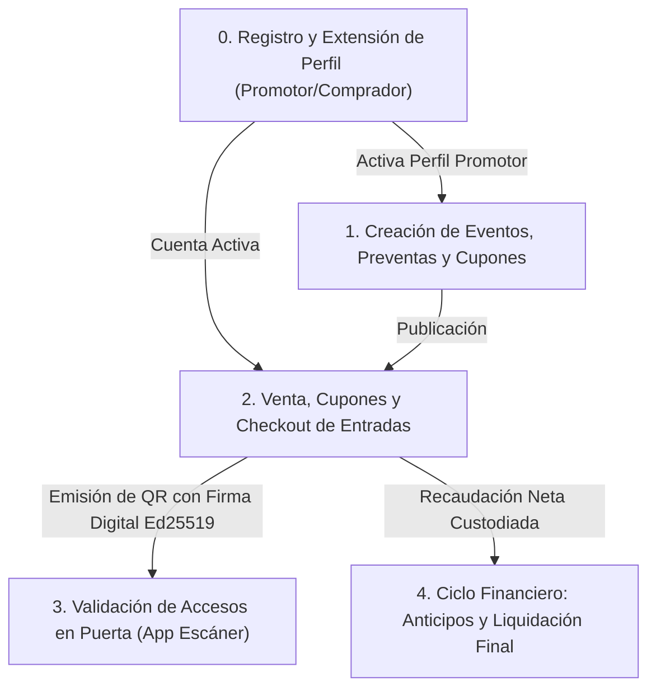

---

## 2. Flujo 0: Registro, Autenticación y Extensión de Perfil (Comprador y Organizador)

Garantiza que una misma persona pueda comprar entradas como cliente final y, cuando lo desee, activar su perfil de promotor para gestionar espectáculos sin registrar cuentas duplicadas.

### 2.1 Diagrama de Secuencia

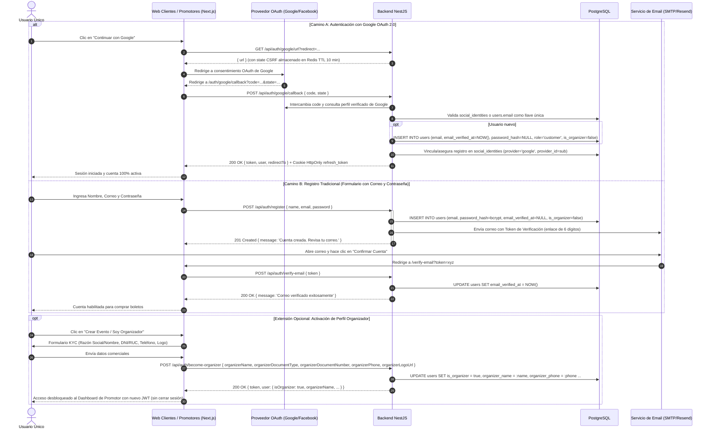

### 2.2 Reglas de Negocio y Endpoints de Autenticación:
* **Endpoints Oficiales de Auth:**
  * `POST /api/auth/register`: Registro tradicional con hashing bcrypt, emisión de token criptográfico de verificación (24h), Access Token (15m) y Refresh Token rotativo en Redis (30d).
  * `POST /api/auth/login`: Autenticación con email/password y retorno de Access Token JWT (15m), Refresh Token rotativo en Redis (30d) y perfil de usuario `{ id, email, role, isOrganizer }`.
  * `GET /api/auth/google/url`: Genera URL OAuth 2.0 de Google con token `state` anti-CSRF almacenado en Redis (TTL 10 min).
  * `POST /api/auth/google/callback`: Intercambia el código recibido en `/auth/google/callback`, valida `state` de un solo uso, busca o vincula el usuario usando `users.email` como llave única en `social_identities` y emite JWT + Refresh Token en Cookie `HttpOnly`.
  * `POST /api/auth/refresh-token`: Renovación de tokens sin fricción. Valida el token contra Redis (`qph:auth:refresh:<userId>:<uuid>`) recibido automáticamente vía Cookie `HttpOnly` (o fallback en body), aplica rotación destruyendo el anterior, emite un nuevo par de tokens y actualiza la cookie.
  * `POST /api/auth/logout`: Cierre de sesión seguro. Invalida y elimina la Cookie `HttpOnly` (`Max-Age=0`).
  * `POST /api/auth/verify-email`: Confirmación de correo mediante token seguro. Actualiza `users.email_verified_at = NOW()`.
  * `POST /api/auth/resend-verification`: Reenvío de enlace de verificación con protección contra spam.
  * `GET /api/auth/me`: Retorna los datos normalizados del usuario autenticado (`AuthUserDto`).
  * `PUT /api/auth/profile`: Actualización de datos de perfil (`name`, `phone`).
  * `POST /api/auth/become-organizer`: Activación de perfil de organizador para cuentas unificadas.
* **Esquema de Autenticación Dual, Cookie HttpOnly y Token Rotation:**
  * El **Access Token** tiene una vigencia corta de **15 minutos** para mitigar riesgos de filtración o robo.
  * El **Refresh Token** se gestiona en **Redis** con un TTL de **30 días** y se transporta exclusivamente mediante **Cookie `HttpOnly; SameSite=Lax; Path=/`** (con bandera `Secure` en producción). Esto previene al 100% el robo por ataques XSS en el navegador, ya que el JavaScript no puede acceder al token.
  * Cada vez que se usa para renovar la sesión en `POST /api/auth/refresh-token`, se destruye atómicamente el token anterior en Redis y se genera uno nuevo (*Token Rotation*), invalidando cualquier token reutilizado maliciosamente y actualizando la cookie en el navegador.
  * El cliente HTTP del frontend (`apiClient`) intercepta de forma transparente los códigos `401 Unauthorized`, envía las credenciales mediante `credentials: 'include'` en segundo plano mediante un mutex que sincroniza peticiones concurrentes y reintenta la solicitud sin interrumpir al usuario.
* **Protección Estricta del Checkout / Compra con JWT:**
  * Toda compra en `POST /api/orders/simulate-checkout` requiere obligatoriamente que el comprador tenga una sesión JWT válida (`401 Unauthorized` si no existe). No se admiten compras anónimas o sin cuenta.
  * En el frontend (`purchase-flow-page.tsx`), antes de avanzar al paso de pago o al confirmar la transacción, se verifica la sesión activa. Si el usuario no ha iniciado sesión, se despliega un modal interactivo con redirección preservando las entradas seleccionadas.
* **Protección Anti-Abuso y Rate Limiting Distribuido (Redis + Throttler):**
  * Todas las rutas públicas y de consulta están protegidas por un Rate Limiter distribuido en Redis (`ThrottlerStorageRedisService`) con cuota de 60 peticiones/minuto por IP. Las solicitudes excedentes reciben `429 Too Many Requests`.
* **Protección de Endpoints Administrativos:**
  * Endpoints como `POST /api/events/admin/seed` y `POST /api/events/admin/sync-expired-status` están protegidos mediante el guard `AdminKeyGuard`, requiriendo el encabezado `x-admin-key` o sesión de usuario con rol `admin`.
* **Verificación de Email Obligatoria (Plan B):** Un usuario con `email_verified_at IS NULL` puede registrar eventos como borrador (`draft`), pero no puede avanzar al checkout de compra ni publicar eventos (`published`).
* **Sesión Única:** El mismo JWT autentica al usuario tanto en la tienda de boletos como en el panel administrativo de promotor.

---

## 3. Flujo 1: Creación de Eventos, Preventas Escalonadas, Cupones y Personalización

Permite al promotor configurar integralmente su evento: ficha técnica, restricción de edad, términos y condiciones (en texto y/o enlace PDF oficial), preguntas frecuentes (FAQs), landing page con croquis de zonas, funciones de shows, precios regulares, hasta 3 preventas escalonadas y cupones de descuento.

### 3.1 Diagrama de Secuencia

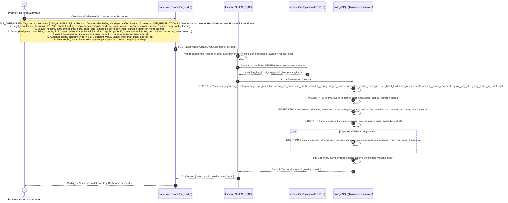

### 3.2 Reglas de Negocio en la Configuración:
* **Precio Regular de la Zona (`zones.regular_price`):** Es la tarifa de lista oficial en Soles (S/.) y permanece perenne. En las tarjetas de zonas, el nombre del sector se presenta en un **badge con el color HEX** configurado y el título comercial de la zona se resalta visualmente con sus beneficios.
* **Escala Oficial Automatizada de Comisión QuePlanesHoy:**
  - **Hasta S/ 50.00:** S/ 6.00 fijos por entrada.
  - **De S/ 51.00 a S/ 125.00:** S/ 10.00 fijos por entrada.
  - **A partir de S/ 126.00:** 8% del precio por entrada (`Math.round(precio * 0.08 * 100) / 100`).
  - **Tarifa Final:** Visualización dinámica en drawer que recalcula el importe final al público según la inclusión o no de la comisión.
  - **Modal Informativo de Tarifario:** Ventana explicativa disponible en el asistente de creación de zonas.
  - **Ocultamiento del Input en Creación:** El promotor no edita la comisión; en el drawer de zonas solo ingresa Aforo y Precio Regular.
  - **Modal de Etapa de Aprobación & Liquidación:** Al pulsar "Publicar Evento", se abre un modal de aprobación donde se desglosan oficialmente las zonas, el precio al comprador, la comisión oficial calculada y la recaudación neta estimada que recibirá el promotor antes de dar el pase a producción.
  - **Modalidad de Comisión (`zones.fee_included`):** Si está activado, la comisión oficial se descuenta del monto a liquidar al promotor; si está desactivado, la comisión se suma al precio final que abona el comprador.
* **Preventas Escalonadas (`zone_pricing_tiers`):** Hasta 3 preventas por zona ordenadas por `tier_number ASC`. El precio promocional debe ser estrictamente menor que `regular_price` y la suma de cupos de preventa no puede exceder el `capacity` total de la zona.
* **Shows y Funciones (`shows`):** Cada función se lista a razón de 1 por fila con un cuadro de calendario (`OCT 15`), hora de inicio, solo hora de cierre de venta de boletos, duración estimada del show en horas enteras (`duration_hours`), aforo asignado y opción de duplicar show con 1 clic.
* **Multimedia, Galería Oficial y Cloudflare R2:** Organización en 2 filas visuales:
  - **Fila 1:** Banner Principal (1920x800) y Croquis de Zonas (Plano del Recinto) en dos columnas.
  - **Fila 2:** Galería de Fotos Oficiales con cuadrícula de 4 slots y **regla estricta de máximo 4 fotos oficiales** (`event_images` con `image_type='gallery'`).
  - **Arquitectura de Subida Directa:** Las imágenes se cargan directamente a **Cloudflare R2** mediante URLs prefirmadas temporales de 5 minutos generadas por el endpoint `POST /api/media/presigned-url`, eliminando el consumo de memoria RAM y ancho de banda del servidor VPS. Se organizan automáticamente por prefijos (`banners/`, `croquis/`, `gallery/`, `landings/`).
* **Categorías y Restricciones Canónicas (`eventConstants.ts`):** Todo evento se clasifica mediante el catálogo unificado `EVENT_CATEGORIES` (`CONCERTS`, `THEATER`, `SPORTS`, `FESTIVALS`, `COMEDY`, `GASTRONOMY`) y su restricción de edad mediante `AGE_RESTRICTIONS` (`ALL_AGES`, `PLUS_14`, `PLUS_18`), facilitando el filtrado en cartelera y consistencia de badges e iconos emoji.
* **Etiquetas de Búsqueda (`events.tags text[]`):** Arreglo de palabras clave administradas desde un control interactivo (con inserción mediante Enter/coma, chips de borrado y sugerencias rápidas) para optimizar el motor de indexación y búsqueda.
* **Landing Page Dedicada, Fondo Personalizado y Live Preview:** Diseño modular y compacto que permite elegir entre un **color de fondo sólido** (`backgroundColor`) o una **imagen pequeña en mosaico** (`backgroundPatternUrl` con repetición `repeat`). Incluye un simulador interactivo en tiempo real (*Live Mini-Preview*) que refleja fielmente el fondo, Hero, 3 atractivos del Body y Footer.
* **Modales Drawer Laterales:** Todos los formularios secundarios (agregar/editar shows, zonas y cupones) se despliegan en paneles laterales (*Drawer*) a pantalla completa vertical en el margen derecho, optimizando la concentración del usuario y el espacio de trabajo.
* **Cupones de Descuento:** Selector de vigencia con campos separados de Fecha (`dd/mm/aaaa`) y Hora (`hh:mm`), previniendo desajustes de hidratación SSR y confusiones de zona horaria.
* **Geolocalización Normalizada:** El distrito se resuelve con el código de 6 dígitos `ubigeo_code` (INEI) y las coordenadas geográficas se almacenan en un único campo `coordinates` (`latitud, longitud`) capturado con el selector de mapa OpenStreetMap / Leaflet.
* **Términos y Condiciones:** Se gestiona exclusivamente mediante enlace web o documento PDF oficial (`terms_and_conditions_url`).
* **Control de Boletos:** Se valida `zones.max_tickets_per_order` (máximo por orden en esa zona) y `events.user_ticket_limit` (límite acumulado por usuario en todo el evento).

### 3.3 Publicación de Eventos y Regla de Oro del Plan B (Email Verification Gate)

Permite al promotor crear y guardar borradores de sus eventos sin ninguna barrera de verificación previa. Sin embargo, para activar la venta pública de entradas y publicar el evento en la cartelera oficial, el sistema aplica una validación criptográfica estricta de correo.

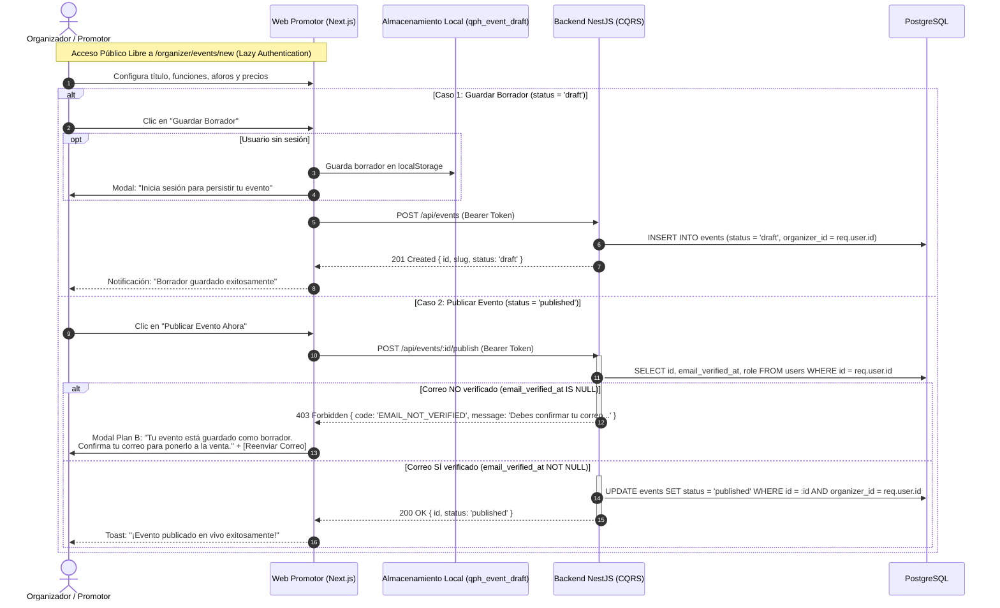

* **Control de Autorización (BOLA / OWASP API1):** El endpoint `/api/events/:id/publish` valida que el `organizer_id` del evento coincida obligatoriamente con el usuario autenticado en el token JWT (o rol `admin`).
* **Edición y Actualización de Borradores (`GET /api/events/organizer/:identifier/edit` y `PUT /api/events/:id`):**
  * `GET /api/events/organizer/:identifier/edit`: Retorna la estructura editable completa del evento (ficha, ubicación, shows, zonas con pricing tiers, cupones, imágenes de galería, FAQs y landing page), permitiendo a los promotores recuperar borradores pendientes incluso cuando `status = 'draft'`. Protegido estrictamente con `JwtAuthGuard` y validación de propiedad (*Ownership Check*).
  * `PUT /api/events/:id`: Endpoint atómico para actualizar la información del evento, sincronizar funciones de shows, reemplazar zonas y preventas escalonadas, actualizar cupones e imágenes, e invalidar de forma automática las claves de caché de Redis asociadas (`qph:events:detail:*`, `qph:events:landing:*`, `qph:home:*`).
  * En el frontend, el acceso se realiza a través de la ruta dinámica `/organizer/events/[id]/edit`, vinculada al botón **"Editar Borrador"** de la lista de eventos (`/organizer/events`).
* **Experiencia de Usuario (Lazy Authentication):** La ruta `/organizer/events/new` no fuerza redirecciones inmediatas al login, permitiendo a visitantes anónimos probar el creador de espectáculos y asegurando los datos en `localStorage` antes de solicitar el inicio de sesión.

---

## 4. Flujo 2: Compra, Validación de Cupones, Control de Concurrencia y Checkout

Controla la alta concurrencia mediante doble ventana temporal (10 min en backend vs 5 min en pasarela), valida límites de compra por checkout y por usuario, aplica cupones de descuento y emite tickets firmados criptográficamente.

### 4.0 Enrutamiento Contextual y Entrada al Checkout (Triada de Navegación Segura Anti-IDOR)
1. **Cartelera Principal / Home:**
   * Si `hasLandingPage = true && slug` $\rightarrow$ Redirige a la landing page dedicada `/e/[slug]`.
   * De lo contrario $\rightarrow$ Redirige a la ficha técnica oficial con UUID público opaco `/events/[publicUuid]`, erradicando el tanteo por ID numérico correlativo (OWASP BOLA / IDOR).
2. **Landing Page Dedicada (`/e/[slug]`):**
   * Disposición panorámica full-width. Al hacer clic en *"Comprar"* en cualquier localidad, envía directamente a `/checkout?eventId=[publicUuid]&zoneId=[zoneId]`.
3. **Ficha Técnica Oficial (`/events/[publicUuid]`):**
   * Carga dinámica de datos oficiales mediante `GET /events/:identifier` apoyada en caché Redis `qph:events:detail:{identifier}` (15 min). Acepta `publicUuid` o `slug`.
   * Al seleccionar una zona o pulsar *"Comprar Entradas"*, deriva a `/checkout?eventId=[publicUuid]` con la zona seleccionada.
4. **Checkout Inteligente (`/checkout`):**
   * Lee `searchParams` (`eventId`, `zoneId`), donde `eventId` es el `publicUuid` seguro del evento. Autoselecciona la primera función disponible y preselecciona 1 entrada (`quantity = 1`) en la zona indicada en `zoneId`.
   * **Autenticación Obligatoria:** Para avanzar al paso de pago o confirmar la compra, se valida que el comprador cuente con sesión activa (JWT). Si no la tiene, se despliega el modal interactivo de autenticación que preserva las entradas seleccionadas y vincula la orden a su cuenta.
   * **Pasarela Real Culqi Checkout Custom (`/api/orders/culqi/*` y `/api/webhooks/culqi`):**
     * `POST /api/orders/culqi/prepare` (JWT): reserva atómicamente tickets en estado `locked`, bloquea zonas/preventas (`FOR UPDATE`), evalúa cupón sin quemarlo aún, crea orden `pending` con `expires_at` configurable (`CULQI_ORDER_EXPIRATION_SECONDS`, default 900s) y genera la orden en Culqi API v2 (`POST /v2/orders`) con `metadata` auditable (`qph_order_id`, `qph_order_uuid`, `qph_user_id`, `qph_user_uuid`, `qph_user_email`) habilitando **Yape / Billeteras QR / Tarjetas / Banca Móvil y Agentes (PagoEfectivo CIP) / Cuotéalo BCP** dentro de **Culqi Checkout Custom** (`https://js.culqi.com/checkout-js`).
     * `POST /api/orders/culqi/confirm-charge` (JWT + BOLA): ejecuta `POST /v2/charges` con `CULQI_SECRET_KEY` enviando `antifraud_details` y `metadata` de trazabilidad completa (`qph_order_id`, `qph_order_uuid`, `qph_user_id`, `qph_user_uuid`, `qph_user_email`, `culqi_order_id`), soporta desafío **3D Secure (`REQUIRES_3DS` -> `Culqi3DS.initAuthentication` -> reenvío con `authentication_3DS`)**, quema el cupón atómicamente (`FOR UPDATE`) y emite tickets `sold` + código QR vía `OrderLifecycleService.finalizePaidOrder` (idempotente).
     * `GET /api/orders/culqi/status/:orderPublicUuid` (JWT + BOLA): consulta activa contra `GET /v2/orders/:id` para pagos asíncronos (QR Billeteras, PagoEfectivo CIP, Cuotéalo) mientras el frontend realiza polling cada 3s.
     * `POST /api/orders/culqi/cancel/:orderPublicUuid` (JWT + BOLA): libera el stock bloqueado cuando el usuario cierra el modal de Culqi sin pagar (validando antes que no se haya pagado en Culqi).
     * `POST /api/webhooks/culqi`: endpoint servidor-a-servidor protegido por Basic Auth (`CULQI_WEBHOOK_USERNAME`/`CULQI_WEBHOOK_PASSWORD`), deduplicación en Redis (`qph:webhook:culqi:*`), verificación activa contra Culqi API v2 (`GET /v2/orders/:id` o `GET /v2/charges/:id`) y finalización idempotente.
     * `OrderExpirationCronService`: audita cada minuto órdenes `pending` vencidas (`expires_at < NOW()`), verifica estado real en Culqi y libera stock `locked` en zonas y tiers.
   * **Simulación de Pasarela (`POST /api/orders/simulate-checkout`):** Se mantiene disponible para pruebas internas de carga con `k6`.

### 4.1 La Doble Ventana de Tiempos
* **15 Minutos (`14:59` en Checkout + `CULQI_ORDER_EXPIRATION_SECONDS=900`):** Ventana persistente en `sessionStorage` del navegador (resiste recargas F5 y redirección de login) acompañada del bloqueo temporal `locked` en PostgreSQL y liberación automática cada 60s vía `OrderExpirationCronService`.
* **Reintento tras Rechazo Bancario:** Si una tarjeta es rechazada en `/confirm-charge`, los tickets permanecen reservados (`pending`/`locked`) hasta la expiración, permitiendo reintentar con otro medio de pago (Yape, otra tarjeta o PagoEfectivo).

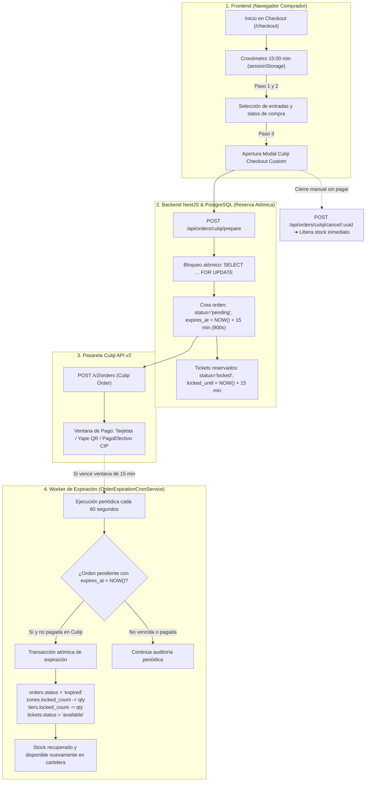

### 4.2 Diagrama de Secuencia

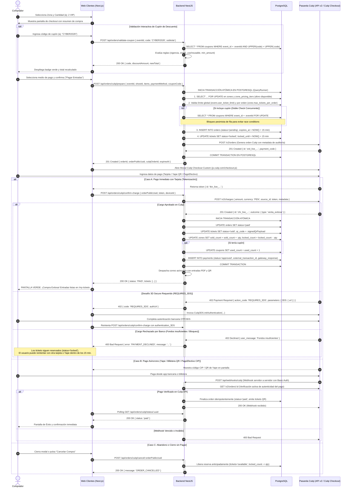

### 4.3 Ciclo de Liberación Dinámica de Stock y Reactivación Automática

El worker en segundo plano se ejecuta periódicamente (cada 60 segundos) para auditar órdenes pendientes:

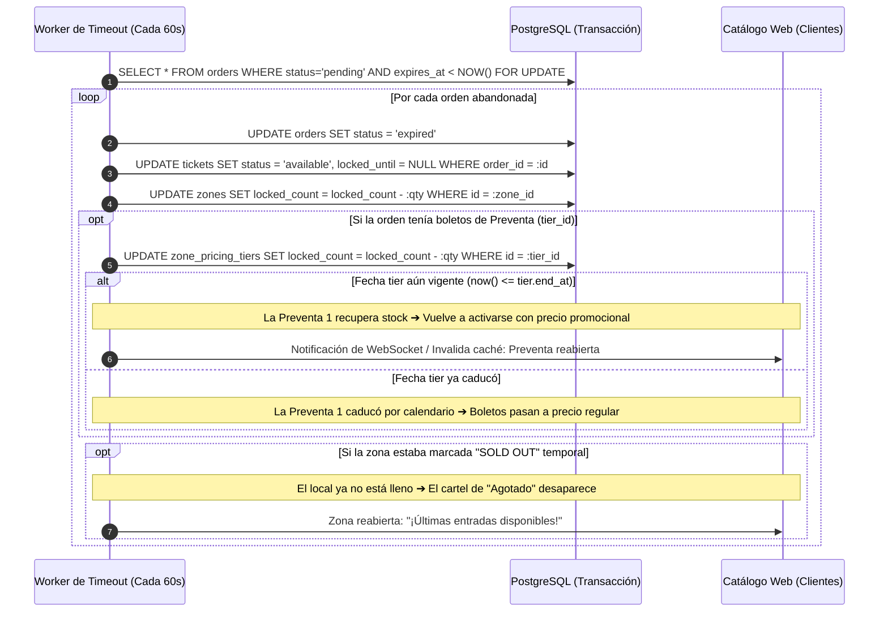

### 4.4 Resiliencia ante Desconexión del Cliente y Garantía en "Mis Boletos"

Para proteger al usuario contra caídas de internet doméstico, cierre accidental del navegador o cuelgues del dispositivo mientras se procesa el pago:

1. **Desacoplamiento Total del Frontend:**
   * La confirmación de la compra **NO depende de que el navegador del usuario permanezca abierto**.
   * Una vez enviado el formulario de tarjeta a la pasarela, la confirmación se ejecuta exclusivamente mediante comunicación **Servidor a Servidor (Webhook)** entre la pasarela y el backend de Qué Planes Hoy.
2. **Procesamiento Autónomo en Servidor:**
   * Aunque el usuario pierda conexión, el webhook bancario es recibido y procesado por el backend:
     * La orden pasa a `paid`.
     * Los tickets pasan a `sold`.
     * Se genera la firma criptográfica Ed25519 y se graba el `qr_code`.
     * Se despacha el correo electrónico de respaldo con los boletos en PDF.
3. **Recuperación Inmediata en "Mis Boletos / Billetera":**
   * Cuando el usuario restablece su conexión o vuelve a iniciar sesión en la plataforma, sus entradas están disponibles de inmediato en su panel personal:
     $$\text{Ruta Frontend: } \texttt{/my-tickets} \quad \longleftrightarrow \quad \text{Endpoint: } \texttt{GET /api/users/me/tickets}$$
   * La interfaz muestra sus códigos QR activos, datos del recinto, horario y opción de descarga sin requerir ninguna acción adicional ni soporte técnico.

---

## 5. Flujo 3: Control de Acceso y Validación de QR en Puerta (App Escáner)

Detalla cómo el personal de puerta escanea los códigos QR, la validación antifraude con `scanned_at` y la contingencia fuera de línea.

### 5.1 Diagrama de Secuencia

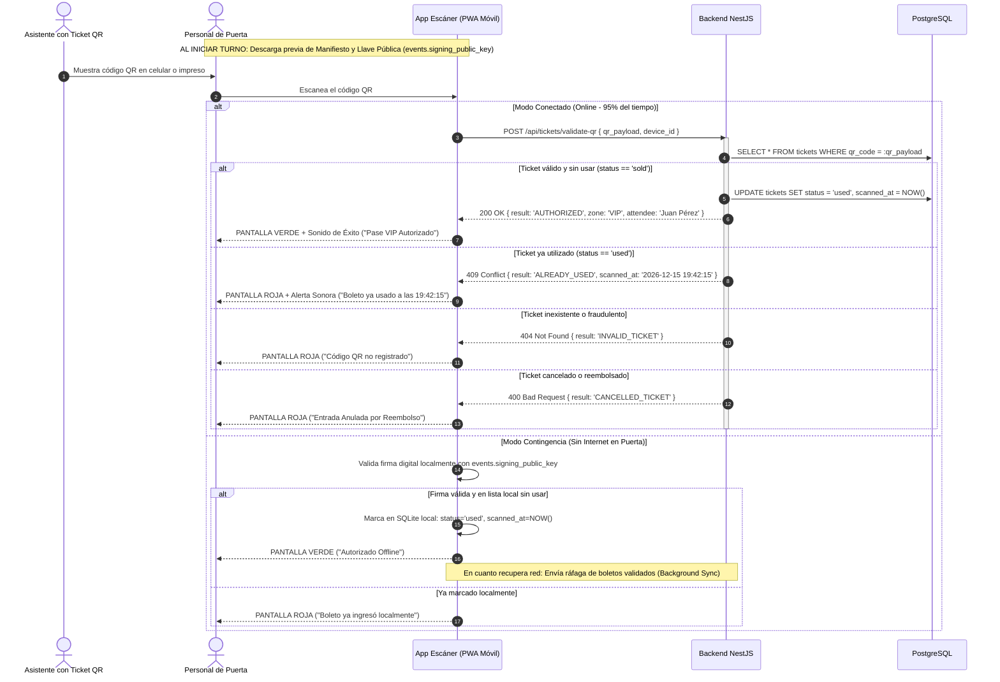

---

## 6. Flujo 4: Ciclo Financiero: Anticipos a Cuenta y Liquidación Final

Regula la custodia del dinero recaudado, el impacto de los cupones de descuento en el saldo disponible, la carga obligatoria de comprobantes bancarios y el cierre definitivo inmutable 1 a 1.

### 6.1 Diagrama de Secuencia

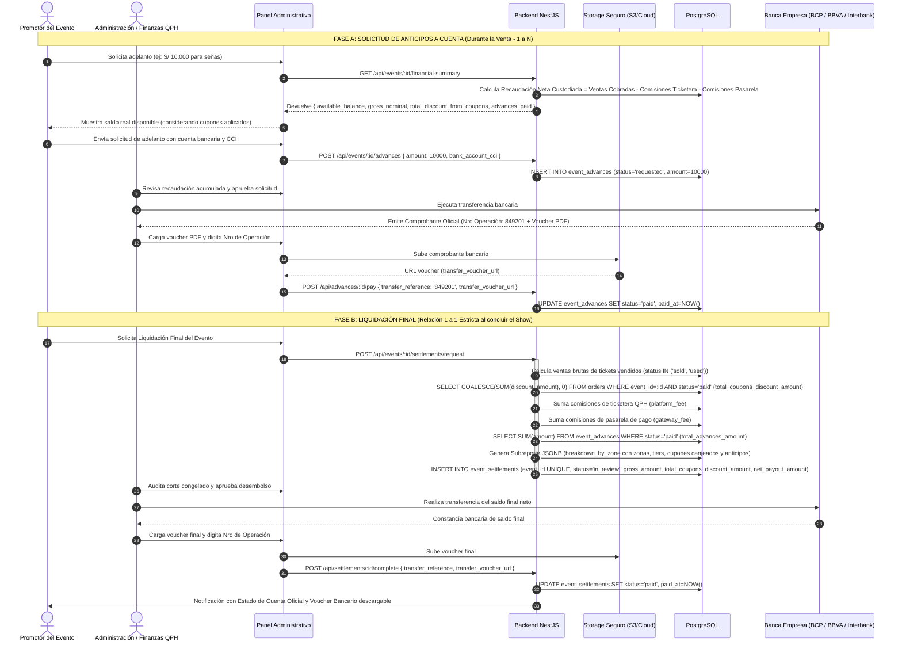

### 6.2 Fórmula de Liquidación Inmutable:
$$\text{Saldo Final a Transferir} = \text{Ventas Brutas} - \mathbf{\text{Total Descuento Cupones}} - \text{Comisión QPH} - \text{Pasarelas} - \mathbf{\text{Total Anticipos Ya Pagados}} - \text{Ajustes}$$

---

## 7. Resumen de Estados de Entidades en los Flujos

| Entidad | Campo de Estado | Valores Posibles | Transición Típica |
| :--- | :--- | :--- | :--- |
| **`users`** | `role` / `is_organizer` / `email_verified_at` | `customer`, `admin` / `false ➔ true` / `NULL ➔ NOW()` | Registro ➔ Verificación Email ➔ Activación Promotor |
| **`events`** | `status` | `draft`, `published`, `paused`, `cancelled` | `draft` ➔ `published` |
| **`shows`** | `status` | `scheduled`, `ongoing`, `completed`, `cancelled` | `scheduled` ➔ `ongoing` ➔ `completed` |
| **`zone_pricing_tiers`** | `is_active` | `true`, `false` | `true` (activo) ➔ `false` (agotado o caducado) |
| **`coupons`** | `is_active` / `usage_type` | `true`, `false` / `single_use`, `reusable` | Creado ➔ Canjeado (`used_count`++) ➔ Agotado |
| **`orders`** | `status` | `pending`, `paid`, `expired`, `cancelled`, `refunded` | `pending` ➔ `paid` (o `expired` a los 10 min) |
| **`tickets`** | `status` | `available`, `locked`, `sold`, `used`, `cancelled` | `available` ➔ `locked` ➔ `sold` ➔ `used` |
| **`payments`** | `status` | `pending`, `approved`, `rejected`, `refunded` | `pending` ➔ `approved` |
| **`event_advances`** | `status` | `requested`, `in_review`, `approved`, `paid`, `rejected` | `requested` ➔ `approved` ➔ `paid` |
| **`event_settlements`** | `status` | `requested`, `in_review`, `approved`, `paid`, `rejected` | `requested` ➔ `approved` ➔ `paid` |

---

## 8. Flujo 5: Búsqueda Instantánea e Indexación con Meilisearch

Garantiza respuestas de búsqueda en menos de 30ms con tolerancia a errores tipográficos (*typo-tolerance*), filtros facetados por categoría/precio/ubigeo y sin sobrecargar la base de datos transaccional PostgreSQL.

### 8.1 Sincronización Automática e Indexación

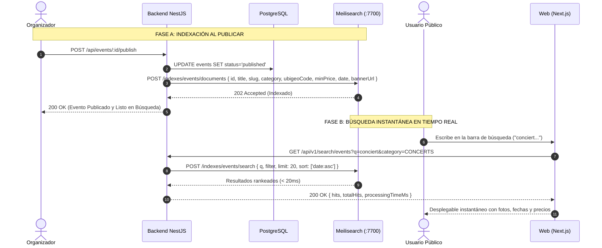

### 8.2 Sincronización Masiva en Lote y Resiliencia DevSecOps

1. **Aislamiento Estricto de Borradores (Draft Isolation):**  
   Meilisearch **NUNCA** almacena eventos en estado `draft`, `paused` o `cancelled`. Al crear un evento, este permanece exclusivamente en PostgreSQL. Solo la aprobación y publicación (`POST /api/events/:id/publish`) lo ingresa al motor de búsqueda. Cualquier llamada a `indexEvent` con un evento no publicado es rechazada y fuerza su eliminación del índice (`removeEvent`).
2. **Reindexación en Lote y Purga de Seguridad (`POST /api/v1/search/sync`):**  
   Ejecuta una purga total de documentos en Meilisearch (`DELETE /indexes/events/documents`) para erradicar cualquier registro residual, y luego reconstruye el catálogo leyendo estrictamente de PostgreSQL con `where: { status: 'published' }`.
3. **Listado Dinámico de Ciudades Activas (`GET /api/v1/search/cities`):**  
   Retorna únicamente las ciudades que cuentan con eventos publicados (`status = 'published'`), con el conteo de eventos activos por ciudad (`eventCount`). Evita desplegar departamentos o regiones sin eventos registrados para proteger la UX de los usuarios.
4. **Degradación Elegante (Modo Pasivo):**  
   Si Meilisearch está reiniciándose o desconectado, las peticiones HTTP del backend cuentan con `AbortSignal.timeout(3000)`. La API no colapsa y devuelve un resultado vacío seguro sin exponer mensajes de infraestructura al cliente.
5. **Privacidad de Arquitectura:**  
   Los payloads y respuestas expuestas al público ocultan los identificadores de motores internos (`engine: Search Engine` / `healthy: true`).

### 8.3 Selección de Eventos Destacados para el Hero Carousel (`GET /api/v1/events/featured`)

1. **Aislamiento de Negocio:** El campo `is_featured` NO se expone en la creación de eventos para evitar auto-asignación por promotores; queda reservado para administración y planes de monetización.
2. **Estrategia Híbrida (Máx 5 Eventos):**
   * Prioridad 1: Consulta eventos con `status = 'published'` e `is_featured = true`.
   * Prioridad 2: Si hay menos de 5, rellena automáticamente con los eventos publicados más recientes hasta completar el cupo.
3. **Navegación Inteligente en Clientes:** Si el evento cuenta con landing page dedicada (`has_landing_page = true` y `slug`), el CTA conduce a `/e/:slug`. De lo contrario, conduce a la vista pública de detalle `/events/:id`.

---

## 9. Flujo 6: Caché en Memoria con Redis para Hero Carousel e Invalidación a Demanda

Garantiza tiempos de respuesta inmediatos (< 3ms) en el Hero Carousel de portada evitando golpear a PostgreSQL con miles de lecturas concurrentes, manteniendo una vigencia automática de 12 horas y proporcionando endpoints administrativos para purga y regeneración en caliente.

### 9.1 Diagrama de Secuencia: Lectura, Cache HIT / MISS y Purga

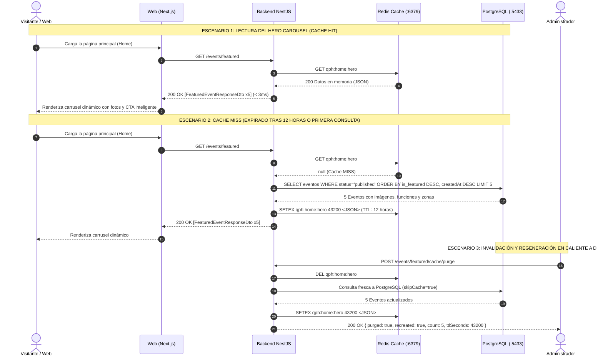

### 9.2 Reglas Operativas y DevSecOps

1. **Namespace Jerárquico en Redis (`qph:home:*`):**
   * `qph:home:hero`: Hero Carousel (TTL: 12 horas).
   * `qph:home:upcoming`: Próximos eventos cronológicos (TTL: 15 minutos).
   * `qph:home:weekly_featured`: Destacados de la semana / selección editorial (TTL: 15 minutos).
   * `qph:home:weekend`: Planes para fin de semana vigente (TTL: 15 minutos).
2. **TTL Adaptativo para Inventario Vivo:**
   * Las secciones con aforo y boletos en movimiento (`upcoming`, `weekly_featured`, `weekend`) operan con un TTL de **15 minutos** (900 s) para refrescar el `urgencyBadge` periódicamente sin sobrecargar la base de datos.
3. **Purga Global de Portada en Caliente (`POST /events/home/cache/purge`):**
   * Emplea `delPattern('qph:home:*')` para erradicar simultáneamente todas las secciones de la Home en Redis.
   * Ejecuta en paralelo las 4 consultas a PostgreSQL (*Cache Warm-up*) y repuebla de inmediato las 4 claves con sus nuevos TTLs, asegurando una experiencia instantánea al siguiente visitante.
4. **Degradación Elegante:** Si la conexión a Redis no está disponible o el servicio se reinicia, el backend loguea una advertencia controlada y efectúa la consulta directamente en PostgreSQL sin lanzar excepciones 500 al cliente.

---

## 10. Flujo 7: Experiencia Inmersiva de Landing Page Dedicada (`/e/[slug]`), Header Teleticket-style y Caché Redis

Permite a eventos especiales con `hasLandingPage = true` ofrecer una experiencia de marca personalizada (fondo por color sólido o patrón en mosaico, botón CTA custom, teaser de YouTube, highlights y tarifas) manteniendo la identidad de la ticketera con un header superior fijo estilo Teleticket y preloader con isotipo animado de QPH.

### 10.1 Diagrama de Secuencia

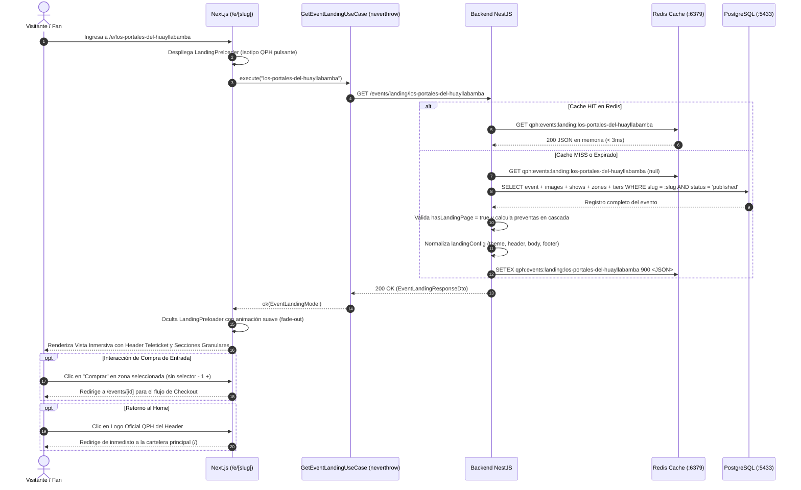

### 10.2 Reglas de Arquitectura Híbrida y Alta Conversión (CRO / UX)

1. **Aislamiento Visual y Diseño Panorámico Full-Width:** La ruta `/e/[slug]` reside fuera de la agrupación `(main)`, heredando únicamente `RootLayout`. Se elimina cualquier contenedor central angosto (`max-w-2xl`), estructurando cada sección para acaparar el 100% del ancho de la pantalla (`w-full`), con fondos cinemáticos en gradiente hacia `deep-slate` y paneles de vidrio (*glassmorphism*).
2. **Navegación Fija estilo Teleticket:**
   * Logo oficial de QPH a la izquierda con enlace directo a `/` para volver a la tienda en cualquier momento.
   * Menú ancla de acceso directo: `INICIO` (`#landing-inicio`), `ENTRADAS` (`#zonas-entradas`), `LEGALES` (`#landing-legales`).
   * Botón CTA destacado con el color principal (`primaryColor`) y texto configurado (`ctaText`).
3. **Franja Flotante de 4 Métricas (`-mt-10`):**
   * Resumen inmediato sin scroll: 📅 *Fecha & Hora*, 📍 *Lugar & Ciudad*, 💳 *Entradas Desde (S/.)*, 🛡️ *Acceso Criptográfico Ed25519*.
4. **Núcleo Transaccional (Zonas + Croquis Lado a Lado):**
   * En pantallas de escritorio, el croquis oficial del escenario (`body.bodyImageUrl`) y el listado de tarifas se sitúan en paralelo (7 columnas para zonas y 5 para croquis). El comprador visualiza la ubicación física y presiona *"Comprar"* sin scroll innecesario ni selectores `- 1 +`.
5. **Cero Fricción y Highlights Compactos:**
   * Se erradica el texto editorial tipo blog. Los atractivos se resumen en viñetas de 1 línea con checks (`primaryColor`) y una barra de 1 clic para copiar la URL amigable con feedback instantáneo (`navigator.clipboard`).

---

## 11. Flujo 8: Tarea Cron de Cierre Automático de Shows y Eventos Vencidos (01:00 AM)

Automatiza el ciclo de vida de espectáculos y funciones en la plataforma, asegurando que las funciones pasadas no admitan compras y que los eventos concluidos se retiren automáticamente de la cartelera pública sin intervención manual de los promotores.

### 11.1 Diagrama de Secuencia: Ejecución del Cron (01:00 AM)

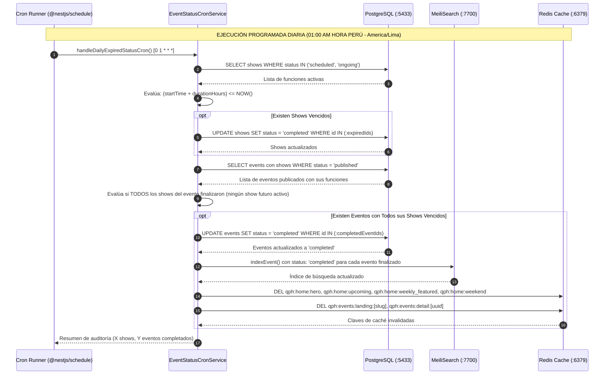

### 11.2 Reglas Operativas y Criterios de Transición

1. **Expresión Cron y Zona Horaria:**
   * Se ejecuta diariamente a la 1:00 AM con la expresión `'0 1 * * *'` bajo la zona horaria del negocio `America/Lima`.
2. **Cálculo de Término de la Función (Show):**
   * Un show se considera finalizado cuando:
     $$\text{Fecha de Fin} = \text{startTime} + \text{durationHours (default 2h)} \le \text{NOW()}$$
   * Al cumplirse esta condición, su estado transiciona a `'completed'`.
3. **Cierre Integral de Eventos:**
   * Un evento con estado `'published'` transiciona a `'completed'` únicamente si **todos sus shows asociados están concluidos** (es decir, ningún show permanece agendado a futuro con fecha vigente).
4. **Sincronización de Búsqueda y Caché:**
   * Al finalizar eventos, se actualiza el estado en MeiliSearch y se invalidan de forma atómica todas las claves de caché de portada en Redis (`qph:home:*`), garantizando que la cartelera pública refleje siempre eventos vigentes.
5. **Disparo Manual / Auditoría:**
   * Se dispone del endpoint `POST /api/events/admin/sync-expired-status` para que administradores o pruebas automatizadas puedan gatillar el proceso bajo demanda.

---

## 12. Flujo 9: Carga Masiva de Eventos de Prueba (Seeding Administrativo)

Permite poblar la base de datos bajo demanda con una cantidad dinámica de eventos realistas (`POST /api/events/admin/seed?count=N`), listos para validar el Hero Carousel, secciones de la Home, filtros por ciudad, Landing Pages y la tarea Cron de eventos vencidos.

### 12.1 Diagrama de Secuencia: Carga Masiva de Eventos

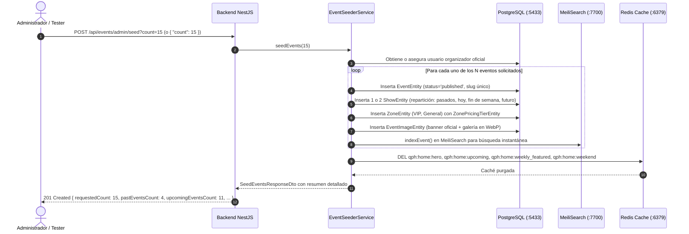

### 12.2 Distribución Temporal de los Eventos Creados

* **25% Eventos Pasados (Hace 1 a 3 días):** Diseñados específicamente para probar la tarea Cron (`POST /api/events/admin/sync-expired-status`) y comprobar que pasan de forma atómica a `completed`.
* **25% Eventos de Hoy (Esta noche a las 21:00):** Para probar los eventos de consumo inmediato en portada.
* **25% Eventos del Fin de Semana (Próximo Sábado):** Para poblar y validar la sección `weekend` de Redis.
* **25% Eventos a Mediano Plazo (En 12 a 35 días):** Para probar la cartelera general, paginación y filtros por categoría y ciudad.

### 12.3 Cupones de Descuento y Experiencia Multimedia (YouTube)

* **Cupones Activos por Evento:** Cada evento genera automáticamente 2 cupones promocionales reutilizables en `coupons`:
  * Cupón Porcentual: `PROMO15-[SUFIJO]` (15% de descuento en el total de entradas).
  * Cupón de Monto Fijo: `VIP20-[SUFIJO]` (S/ 20.00 de rebaja directa con compra mínima de S/ 60.00).
* **Teaser de YouTube en Landing Pages:** Los eventos con `hasLandingPage = true` configuran un enlace oficial de YouTube en `landingConfig.header.videoTeaserUrl`, habilitando en el frontend el botón flotante de reproducción y el modal `VideoTeaserModal`.

---

## 13. Flujo 13: Lista de Favoritos (Persistencia y Sincronización)

Permite a los usuarios marcar/desmarcar eventos como favoritos desde tarjetas o páginas de detalle, sincronizando en tiempo real la colección personal del usuario con la base de datos `user_favorite_events`.

### 13.1 Diagrama de Secuencia

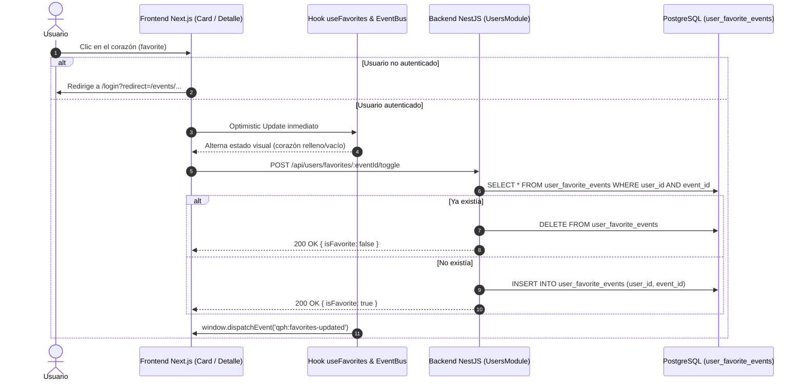

---

## 14. Flujo 14: Restablecimiento de Contraseña (Password Reset con Token Temporal)

Flujo seguro en 2 pasos para recuperar el acceso a la cuenta con tokens encriptados con caducidad (10-15 min) y rate limiting anti-fuerza bruta.

### 14.1 Diagrama de Secuencia

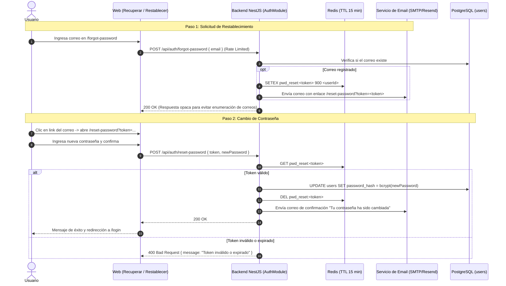

### 14.2 Cambio de Contraseña Autenticado (`POST /api/auth/change-password`)
- Protegido con `JwtAuthGuard` y limitador `@Throttle` (máx. 5 intentos cada 15 min).
- Valida mediante `ChangePasswordHandler` que el usuario autenticado posea contraseña local (`password_hash`), compara `oldPassword` con bcrypt (`INVALID_CURRENT_PASSWORD` → HTTP 400 si no coincide), exige que `newPassword` sea distinta a la actual (mín. 6 caracteres), actualiza `users.password_hash` y envía notificación informativa por correo.

---

## 15. Servicio Transaccional de Correos (`MailModule` + Resend API)

Módulo global (`@Global()`) ubicado en `src/modules/mail/` encargado de despachar los correos transaccionales de la plataforma mediante la API REST oficial de **Resend** (`POST https://api.resend.com/emails`) con timeout explícito (`RESEND_TIMEOUT_MS`, default `5000ms`), fallback controlado a consola local cuando `RESEND_API_KEY` no está configurada (sin imprimir enlaces/tokens en producción) y sanitización HTML estricta en `mail-template.builder.ts`.

* **Métodos y plantillas implementados en `MailService` (`TicketPdfService` + `mail-template.builder.ts`):**
  * `sendEmail(input)`: envío genérico tipado con HTML, texto alternativo, `reply_to`, `tags` y soporte para adjuntos Base64 (`attachments`) e imágenes inline (`content_id` / `cid:`).
  * `sendVerificationEmail`: verificación de correo electrónico en registro/reenvío (`AuthModule`).
  * `sendWelcomeGoogleEmail`: bienvenida automática para usuarios nuevos registrados por primera vez mediante Google OAuth (`GoogleCallbackHandler`).
  * `sendPasswordResetEmail`: recuperación de contraseña de un solo uso con vigencia de 15 minutos (`AuthModule`).
  * `sendPasswordChangedNotificationEmail`: alerta informativa cuando se actualiza o restablece la contraseña (`AuthModule`).
  * `sendOrderTicketsEmail`: disparado automáticamente al pasar una orden a `paid` en `OrderLifecycleService.finalizePaidOrder` (una sola vez); adjunta el documento **PDF oficial (`entradas-#QPH-XXXXXX.pdf`)** generado con `TicketPdfService` (`pdfkit` + `qrcode`), incrusta los QR inline (`cid:`) en el cuerpo HTML (hasta 6 tickets inline) y enlaza al visor web (`/profile/tickets`).
  * `sendOrganizerActivatedEmail`: confirmación automática al habilitar el perfil comercial de Organizador (`BecomeOrganizerHandler`).
  * `sendOrganizerKycVerifiedEmail`: plantilla lista para aprobación administrativa KYC de la productora.
  * `sendEventPublishedEmail`: confirmación automática al promotor cuando publica un evento (`PublishEventHandler`) con el enlace público (`/e/:slug` o `/events/:uuid`).
  * `sendAdvancePaidEmail` y `sendSettlementPaidEmail`: plantillas listas para notificar desembolsos bancarios de anticipos y cierre contable de liquidación final.

---

## 16. Panel del Organizador: Listado Real de Mis Eventos (`GET /api/events/organizer`)

Endpoint protegido con `JwtAuthGuard` en `EventsController` (ubicado antes de `GET /api/events/:identifier` para evitar colisión de rutas) atendido por `GetOrganizerEventsHandler`:

1. **Aislamiento de Propietario (BOLA - OWASP API1):** Filtra estrictamente `events.organizer_id = user.id` resuelto desde el JWT verificado (`req.user.sub`), ignorando cualquier identificador externo.
2. **Código y Estados Reales:** Genera `eventCode` determinístico (`#EV-${publicUuid.substring(0, 8).toUpperCase()}`) y alinea los estados reales (`draft`, `published`, `paused`, `completed`, `cancelled`, más indicador `isSoldOut` cuando `ticketsSold >= capacity` y preventa activa vigente).
3. **Métricas Agregadas Parametrizadas (PostgreSQL):**
   * Suma boletos confirmados (`tickets.status IN ('sold', 'used')`) y `paid_base_price` agrupados por `event_id` y `zone_id` para reflejar el monto real vendido según cada fase de preventa.
   * Calcula los descuentos de cupones aplicados (`orders.discount_amount` de órdenes `paid`, deduplicando por `order.id`) usando `COALESCE(orders.event_id, shows.event_id)`.
   * Expone `netSalesRevenue` (`grossRevenue - couponsDiscountAmount`), `targetRevenue` (`SUM(zone.capacity * zone.regularPrice)`), `settlementStatus`, y `draftChecklist` dinámico para borradores.

